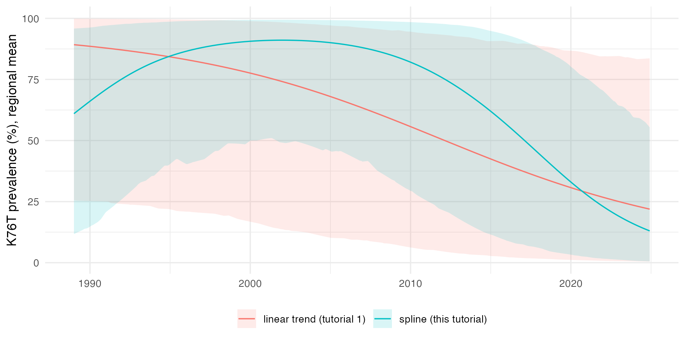
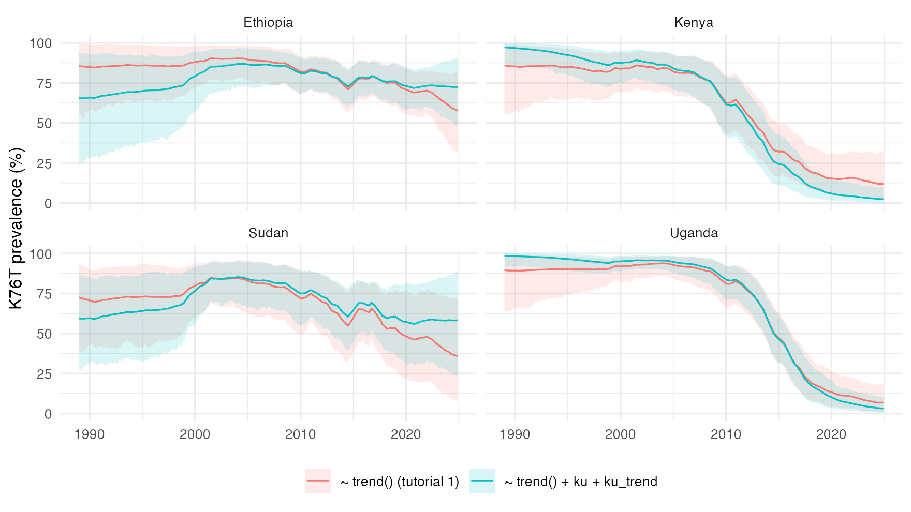

# 3. Covariates

The fit of [tutorial
1](https://mrc-ide.github.io/stareal/articles/crt76t.md) had the default
mean, an intercept and a linear trend in time, and the spatial-temporal
field did the rest. Covariates move part of that variation into the
mean. They can explain it, and they let areas with the same covariate
values borrow strength from each other, including areas with no surveys.

*stareal* takes covariates as tables keyed by area, by time step, or by
both. This tutorial uses the crt K76T data of tutorial 1, and builds its
covariates from the frame itself: a smooth regional trend, and a
contrast between Kenya and Uganda and the rest of the region. The last
section shows how to build the same tables from a raster of your own,
such as transmission intensity or elevation.

``` r
library(stareal)
```

## 1. The data

As in tutorial 1, with the example data that ship with *stareal*:

``` r
iso3 <- c("DJI", "ERI", "ETH", "KEN", "SOM", "SSD", "SDN", "UGA")
adm1 <- sf::st_as_sf(geodata::gadm(iso3, level = 1, path = tempdir(), version = "4.1", resolution = 2))
lakes <- rnaturalearth::ne_download(scale = 10, type = "lakes", category = "physical",
                                    returnclass = "sf", destdir = tempdir())
crs <- "+proj=laea +lat_0=8 +lon_0=37 +units=m"
adm1 <- sf::st_make_valid(sf::st_transform(adm1, crs))
lakes <- sf::st_make_valid(sf::st_transform(lakes, crs))
lakes <- lakes[as.numeric(sf::st_area(lakes)) > 1e9, ]
water <- sf::st_intersection(sf::st_union(lakes), sf::st_union(adm1))
adm1 <- sf::st_difference(adm1, water)
adm1 <- adm1[adm1$ENGTYPE_1 != "Water body", ]           # what is left of Uganda's lake units
fr <- areal_frame(adm1, id = "GID_1", groups = c(country = "COUNTRY"), link_within = "country",
                  verbose = FALSE)
tf <- time_frame(1989, 2024, "month")
d <- areal_data(igad_crt76t, fr, tf, y = "positive", k = "tested",
                coords = c("longitude", "latitude"), date = "collection_day", verbose = FALSE)
```

## 2. Three kinds of covariate table

A covariate table is an ordinary data frame. Its key columns say what it
varies over:

| Key columns                           | Varies by          | One row per    |
|---------------------------------------|--------------------|----------------|
| `id`                                  | area               | area           |
| `time` (labels) or `t` (step numbers) | time step          | time step      |
| `id` and `time` (or `t`)              | area and time step | area-time cell |

Every other column is a covariate, named in the formula as it is named
in the table. **A table must cover every area, every step or every cell
of the frame**, not just the surveyed ones, because
[`predict()`](https://rdrr.io/r/stats/predict.html) needs the covariates
everywhere. Transforms and interactions are computed as columns first:
the formula takes plain names (and
[`trend()`](https://mrc-ide.github.io/stareal/reference/trend.md)), not
`log(x)` or `x:z`.

The three tables of this tutorial:

``` r
# by time: a natural spline in calendar time, 3 degrees of freedom
year <- 1989 + (seq_len(tf$n_steps) - 1) / 12
basis <- splines::ns(year, df = 3)
by_time <- data.frame(time = tf$labels, s1 = basis[, 1], s2 = basis[, 2], s3 = basis[, 3])

# by area: 1 in Kenya and Uganda, 0 elsewhere
by_area <- data.frame(id = fr$ids, ku = as.numeric(fr$groups$country %in% c("Kenya", "Uganda")))

# by area and time: ku times a linear trend from -1 in the first month to 1 in the last
by_cell <- expand.grid(id = fr$ids, time = tf$labels, stringsAsFactors = FALSE)
by_cell$ku_trend <- by_area$ku[match(by_cell$id, by_area$id)] *
  seq(-1, 1, length.out = tf$n_steps)[match(by_cell$time, tf$labels)]

head(by_time, 3)
#>      time           s1          s2           s3
#> 1 1989-01  0.000000000 0.000000000  0.000000000
#> 2 1989-02 -0.001764743 0.005294396 -0.003529598
#> 3 1989-03 -0.003529001 0.010588352 -0.007058901
head(by_area, 3)
#>        id ku
#> 1 DJI.1_2  0
#> 2 DJI.6_1  0
#> 3 DJI.2_1  0
c(rows = nrow(by_cell), areas = fr$m, steps = tf$n_steps)
#>  rows areas steps 
#> 74304   172   432
```

`ku_trend` is built to match
[`trend()`](https://mrc-ide.github.io/stareal/reference/trend.md), which
also runs from −1 at the first step to 1 at the last.

### Standardised or not

By default, numeric covariates are standardised: mean 0 and sd 1 over
the areas, steps or cells of their table. A coefficient is then the
effect of one sd, and the default prior on the fixed effects (normal, sd
3 on the logit scale) suits any units. Factors become one 0/1 column per
level after the first, and are not standardised.

The covariates here are already on a unit scale, and their coefficients
are easier to read unstandardised, so the fits below use
`scale_covariates = FALSE`. With covariates in large units, such as
population or rainfall in millimetres, keep the default.

## 3. A covariate by time: a smooth regional trend

[`trend()`](https://mrc-ide.github.io/stareal/reference/trend.md) makes
the regional mean a straight line on the logit scale. Anything else,
such as a decline that starts late and then levels off, is left to the
field. A spline basis in the year lets the mean bend:

``` r
fit_smooth <- fit_areal(d, ~ s1 + s2 + s3, covariates = by_time, scale_covariates = FALSE)
diagnose(fit_smooth)$checks
#>                      check      value threshold direction pass
#> 1        theta R-hat (max)   1.004871      1.05        <= TRUE
#> 2         beta R-hat (max)   1.005461      1.05        <= TRUE
#> 3       latent R-hat (max)   1.009609      1.05        <= TRUE
#> 4     theta bulk ESS (min) 879.064798    400.00        >= TRUE
#> 5      beta bulk ESS (min) 857.784809    400.00        >= TRUE
#> 6 latent bulk ESS (median) 967.454713    100.00        >= TRUE
summary(fit_smooth)
#> <stareal_fit summary> 264 observed cells; 4 chains, 2000 iterations after burn-in
#>   hyperparameters from the trace (8000 draws), fixed effects from the 1000 stored draws
#> 
#>   variable    mean      sd   q2.5     q50  q97.5  rhat ess_bulk ess_tail
#>      sigma  3.2500 0.36400  2.600  3.2300  4.010 1.003     1534     2388
#>      rho_s  0.9390 0.05180  0.799  0.9540  0.990 1.003     1292     2129
#>      rho_t  0.9970 0.00107  0.995  0.9970  0.999 1.005     1350     2310
#>    sigma_n  0.6840 0.10600  0.483  0.6820  0.901 1.003      879     1220
#>  intercept  0.5820 1.32000 -2.020  0.6160  3.130 1.001      984      952
#>         s1 -0.0914 1.38000 -2.920 -0.0683  2.770 1.005     1039      972
#>         s2  1.0200 2.13000 -3.210  1.0600  5.090 0.999      858      844
#>         s3 -4.9100 1.38000 -7.430 -4.9000 -2.040 1.001     1015      832
#> 
#> acceptance after burn-in: centred 0.26, surrogate 0.24; 0.0187 s per iteration
#> for every observed cell and a verdict, use diagnose()
```

For comparison, the fit of tutorial 1, with the default `~ trend()`:

``` r
fit_linear <- fit_areal(d)
```

The spline coefficients mean little one by one. The curve they make
does: the regional mean on the prevalence scale, draw by draw, beside
the straight line of tutorial 1. (This is the prevalence where the field
is zero, roughly the median unit, not the average over units.)

``` r
curve <- function(fit, X) {
  b <- posterior::as_draws_matrix(fit)[, colnames(X)]
  p <- 100 * plogis(unclass(b) %*% t(X))                 # percent
  data.frame(year = year, mean = colMeans(p),
             lo = apply(p, 2, quantile, 0.025), hi = apply(p, 2, quantile, 0.975))
}
X_smooth <- cbind(intercept = 1, by_time[, c("s1", "s2", "s3")])
X_linear <- cbind(intercept = 1, trend = seq(-1, 1, length.out = tf$n_steps))
both <- rbind(cbind(curve(fit_smooth, as.matrix(X_smooth)), mean_model = "spline (this tutorial)"),
              cbind(curve(fit_linear, X_linear), mean_model = "linear trend (tutorial 1)"))
ggplot(both, aes(year, mean, colour = mean_model, fill = mean_model)) +
  geom_ribbon(aes(ymin = lo, ymax = hi), alpha = 0.15, colour = NA) +
  geom_line() +
  labs(x = NULL, y = "K76T prevalence (%), regional mean", colour = NULL, fill = NULL) +
  theme_minimal() + theme(legend.position = "bottom")
```



The straight line cannot bend. The spline shows the shape the data
support: K76T close to fixation from the late 1990s to about 2008, then
a fall, steepest after 2010. Two things qualify it:

- **The bands are wide.** The curve is the prevalence where the field is
  zero. With `rho_s` and `rho_t` both close to 1, the field has a slowly
  varying region-wide component of its own, and it trades off against
  the fixed effects. The data fix their sum better than either part.
- **A regional curve averages unlike places.** Since 2015 there have
  been 65 surveys in Kenya and Uganda, where K76T fell, and 57
  elsewhere, mostly in Ethiopia and Sudan, where it is still common. The
  fall after 2015 is an average of the two, and true of neither. Section
  4 separates them. The rise before 1995 rests on only 6 surveys, and
  may not be real.

The hyperparameters change too. `rho_s` falls from 0.97 with the
straight line to 0.94 with the spline, and its interval widens. The
reason is in the Leroux prior: the variance of the field’s average over
the whole region is proportional to `sigma^2 / (1 - rho_s)`. With a
straight-line mean, the field has to carry the bend in the regional
curve, and a `rho_s` close to 1 is what lets it. With the bend in the
mean, it needs less of that. A covariate changes what the field has to
explain, so the field’s parameters are only comparable between models
with the same mean.

## 4. Covariates by area, and by area and time

The country curves of tutorial 1 suggest that K76T fell sooner in Kenya
and Uganda than elsewhere. Is the difference real, or could the field
have made it by chance? `ku` shifts the level in Kenya and Uganda,
measured at the middle of the window, where
[`trend()`](https://mrc-ide.github.io/stareal/reference/trend.md) is 0.
`ku_trend` changes their slope:

Several tables go in as a list. Each covariate must be in exactly one of
them.

``` r
fit_ku <- fit_areal(d, ~ trend() + ku + ku_trend, covariates = list(by_area, by_cell),
                    scale_covariates = FALSE)
diagnose(fit_ku)$checks
#>                      check      value threshold direction pass
#> 1        theta R-hat (max)   1.005836      1.05        <= TRUE
#> 2         beta R-hat (max)   1.004984      1.05        <= TRUE
#> 3       latent R-hat (max)   1.010762      1.05        <= TRUE
#> 4     theta bulk ESS (min) 874.213996    400.00        >= TRUE
#> 5      beta bulk ESS (min) 923.892024    400.00        >= TRUE
#> 6 latent bulk ESS (median) 971.293910    100.00        >= TRUE
summary(fit_ku)
#> <stareal_fit summary> 264 observed cells; 4 chains, 2000 iterations after burn-in
#>   hyperparameters from the trace (8000 draws), fixed effects from the 1000 stored draws
#> 
#>   variable    mean      sd   q2.5     q50  q97.5  rhat ess_bulk ess_tail
#>      sigma  2.6600 0.34100  2.060  2.6400  3.400 1.004     1085     1631
#>      rho_s  0.9780 0.02270  0.924  0.9840  0.996 1.005     1323     2006
#>      rho_t  0.9970 0.00117  0.995  0.9980  0.999 1.002     1133     1893
#>    sigma_n  0.7100 0.09920  0.523  0.7080  0.905 1.006      874     1751
#>  intercept  1.0900 1.44000 -2.050  1.1700  3.960 0.998      998      841
#>      trend  0.0896 1.13000 -2.160  0.0989  2.280 1.005     1062      943
#>         ku -0.6640 0.93200 -2.440 -0.6510  1.200 1.000      947      927
#>   ku_trend -5.5000 1.05000 -7.610 -5.5300 -3.480 0.999      924     1030
#> 
#> acceptance after burn-in: centred 0.20, surrogate 0.21; 0.018 s per iteration
#> for every observed cell and a verdict, use diagnose()
```

The posterior probability that the decline was steeper in Kenya and
Uganda is the share of draws with `ku_trend` below zero:

``` r
b <- posterior::as_draws_matrix(fit_ku)
mean(b[, "ku_trend"] < 0)
#> [1] 1
```

The probability is close to 1: the decline was steeper in Kenya and
Uganda, and the field, which could have produced a local decline on its
own, does not account for the difference. Read the coefficients
together:

- `trend` is now the slope outside Kenya and Uganda, and it is close to
  zero (0.1, with an interval from -2.2 to 2.3). Ethiopia’s and Sudan’s
  recent surveys still find K76T in most infections.
- `trend + ku_trend` is the slope in Kenya and Uganda, about -5.4: a
  fall of about 11 on the logit scale over the window.
- `ku`, the difference in level at the middle of the window (late 2006),
  has an interval that spans zero.

`sigma` falls, from 3.2 to 2.7, as the contrast takes over part of the
variation that the field carried.

## 5. A factor level with no data

Is K76T different in cities? GADM gives Ethiopia’s two chartered cities,
Addis Ababa and Dire Dawa, units of their own. Neither has a crt survey,
so the data say nothing about a city effect.
[`fit_areal()`](https://mrc-ide.github.io/stareal/reference/fit_areal.md)
says so before it starts sampling:

``` r
by_type <- data.frame(id = fr$ids,
                      setting = factor(ifelse(adm1$ENGTYPE_1[match(fr$ids, adm1$GID_1)] == "City", "city", "other"),
                                       levels = c("other", "city")))
tryCatch(fit_areal(d, ~ trend() + setting, covariates = by_type, control = list(verbose = FALSE)),
         warning = function(w) conditionMessage(w))
#> [1] "the observed cells do not inform the fixed effect(s) settingcity (collinear with the others over the observed cells, e.g. a factor level or time step with no data): their posterior is their prior, and predictions where they apply carry that uncertainty"
```

The posterior of `settingcity` would be its prior, and every prediction
for the two cities would carry that prior’s uncertainty, on top of the
field’s. Three remedies:

- **Merge the level** with others, as `ku` does for the countries
  outside Kenya and Uganda.
- **Give it an informative prior**, by name:
  `priors = areal_priors(beta_sd = c(settingcity = 0.5))`.
- **Leave the covariate out** and let the field carry the differences,
  as in tutorial 1.

A factor’s first level is its baseline, and the levels are alphabetical
by default. Above, `levels = c("other", "city")` makes the surveyed
units the baseline; alphabetical order would have made the unsurveyed
cities the baseline instead.

## 6. Predicting with covariates

Nothing changes: [`predict()`](https://rdrr.io/r/stats/predict.html)
evaluates the covariates in every area and month from the tables the fit
was given.

``` r
pr_ku <- predict(fit_ku, groups = "country")
pr_linear <- predict(fit_linear, groups = "country")
```

``` r
countries <- c("Kenya", "Uganda", "Ethiopia", "Sudan")
cmp <- rbind(cbind(pr_linear$groups$country, model = "~ trend() (tutorial 1)"),
             cbind(pr_ku$groups$country, model = "~ trend() + ku + ku_trend"))
cmp <- cmp[cmp$id %in% countries, ]
ggplot(cmp, aes(date, mean, colour = model, fill = model)) +
  geom_ribbon(aes(ymin = q2.5, ymax = q97.5), alpha = 0.15, colour = NA) +
  geom_line() +
  facet_wrap(~id) +
  labs(x = NULL, y = "K76T prevalence (%)", colour = NULL, fill = NULL) +
  theme_minimal() + theme(legend.position = "bottom")
```



In Kenya and Uganda the two models agree: the data there decide. In
Ethiopia and Sudan they part after the last surveys (2022 in Ethiopia,
2018 in Sudan). Tutorial 1’s model carries the region’s decline into
them. The covariate model does not, because the decline belongs to Kenya
and Uganda. In July 2024 it puts Ethiopia at about 72%, against 59%, and
Sudan at about 58%, against 37%. Neither number comes from recent data
in those countries. Each follows from what the mean assumes where the
surveys stop. A covariate changes the map most where the data are
thinnest, which is where it most needs to be right.

Whether either covariate model predicts better than tutorial 1’s is a
question for
[cross-validation](https://mrc-ide.github.io/stareal/articles/crossval.md),
which compares them with it, and with two simpler models, on the same
held-out surveys.

## 7. Your own covariates from a raster

Most real covariates come as rasters: transmission intensity, rainfall,
elevation, population. `exactextractr` averages a raster over each
polygon, and a raster with one layer per time step gives a table by area
and time step:

``` r
r <- terra::rast("my_covariate.tif")             # one layer per month, named "2000-01", "2000-02", ...
ex <- exactextractr::exact_extract(r, adm1, "mean")
by_cell <- data.frame(id = rep(adm1$GID_1, times = ncol(ex)),
                      time = rep(sub("^mean[.]", "", names(ex)), each = nrow(ex)),
                      my_covariate = unlist(ex, use.names = FALSE))
```

A yearly raster with a monthly time frame gives each month its year’s
value: match on the year of each time label.

Two things to settle before fitting:

- **Coverage.** The table must cover every time step of the time frame.
  A raster that starts later than the surveys needs a stated rule for
  the earlier steps, such as holding the first value, or a shorter time
  frame.
- **Area, not survey.** A covariate here describes an area in a time
  step, and must be known for every one of them. Properties of a survey
  (the study design, the sampled population) are not covariates of this
  model.

## What next

- [4. Cross-validation and model
  comparison](https://mrc-ide.github.io/stareal/articles/crossval.md):
  do these covariates improve the predictions?
- [Method](https://mrc-ide.github.io/stareal/articles/method.md): how
  the fixed effects are integrated out with the unsurveyed cells.
