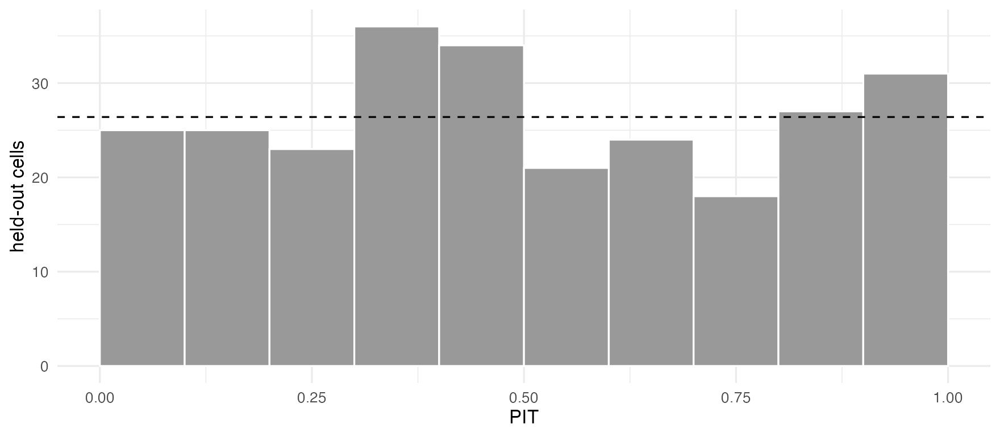
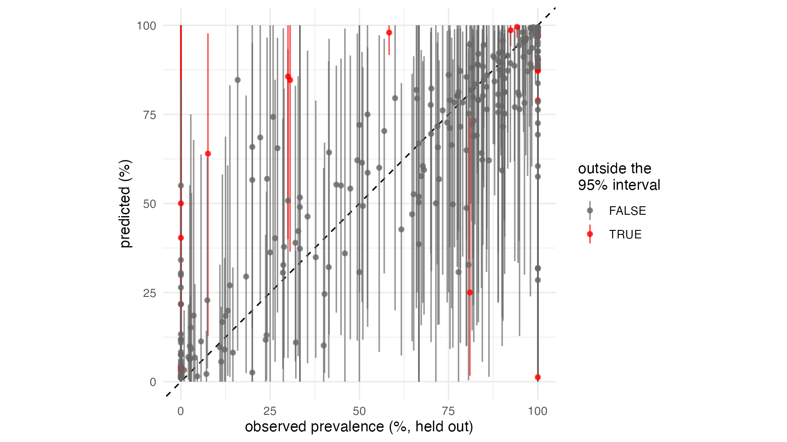

# 4. Cross-validation and model comparison

[`diagnose()`](https://mrc-ide.github.io/stareal/reference/diagnose.md)
says whether the sampler has found the posterior. It does not say
whether the model is any good. Cross-validation asks a sharper question:
how well does a model predict surveys it has not seen? This tutorial
uses the crt K76T data of [tutorial
1](https://mrc-ide.github.io/stareal/articles/crt76t.md) to show how to:

- check that a model’s predictive intervals are calibrated;
- compare models on the same held-out data, with an honest standard
  error;
- hold out whole countries, to test extrapolation rather than
  interpolation.

``` r
library(stareal)
```

## 1. How `crossval()` works

[`crossval()`](https://mrc-ide.github.io/stareal/reference/crossval.md)
splits the observed area-time cells into folds. It holds out each fold
in turn, refits the model to the rest, and predicts the held-out cells.
Each prediction is scored against the surveys:

- **log score**: the log probability the model gave to the observed
  count. It is higher for better models, and is the main basis for
  comparison.
- **outside the 95% interval**: about 5% for a calibrated model. The
  check uses a randomised PIT (probability integral transform), so 5% is
  the right target whatever the number tested.
- **RMSE** and **correlation** of the predicted against the observed
  prevalence: easy to read, but blind to the intervals.

Each fold is a full refit, so 10-fold cross-validation costs 10 fits.
The refits can be shorter than a publication run: they only need to pass
[`diagnose()`](https://mrc-ide.github.io/stareal/reference/diagnose.md),
as the default settings do for these data (tutorial 1).

Why not leave-one-out on the fitted model (PSIS-LOO, as in the `loo`
package)? With one latent value per observed cell, each cell’s posterior
leans heavily on its own data, and the importance weights become
unstable. Refitting is slower, but it is reliable.

## 2. Five models, one set of folds

The data of tutorial 1:

``` r
iso3 <- c("DJI", "ERI", "ETH", "KEN", "SOM", "SSD", "SDN", "UGA")
adm1 <- sf::st_as_sf(geodata::gadm(iso3, level = 1, path = tempdir(), version = "4.1", resolution = 2))
lakes <- rnaturalearth::ne_download(scale = 10, type = "lakes", category = "physical",
                                    returnclass = "sf", destdir = tempdir())
crs <- "+proj=laea +lat_0=8 +lon_0=37 +units=m"
adm1 <- sf::st_make_valid(sf::st_transform(adm1, crs))
lakes <- sf::st_make_valid(sf::st_transform(lakes, crs))
lakes <- lakes[as.numeric(sf::st_area(lakes)) > 1e9, ]
water <- sf::st_intersection(sf::st_union(lakes), sf::st_union(adm1))
adm1 <- sf::st_difference(adm1, water)
adm1 <- adm1[adm1$ENGTYPE_1 != "Water body", ]           # what is left of Uganda's lake units
fr <- areal_frame(adm1, id = "GID_1", groups = c(country = "COUNTRY"), link_within = "country",
                  verbose = FALSE)
tf <- time_frame(1989, 2024, "month")
d <- areal_data(igad_crt76t, fr, tf, y = "positive", k = "tested",
                coords = c("longitude", "latitude"), date = "collection_day", verbose = FALSE)
```

Five models: the default of tutorial 1, two simpler ones (without the
cell nugget, and without the trend), and the two covariate models of
[tutorial 3](https://mrc-ide.github.io/stareal/articles/covariates.md),
whose tables `by_time`, `by_area` and `by_cell` are built as there. Each
is cross-validated with ten random folds:

``` r
models <- list(
  default      = fit_areal(d),
  no_nugget    = fit_areal(d, nugget = FALSE),
  no_trend     = fit_areal(d, formula = ~ 1),
  smooth_trend = fit_areal(d, ~ s1 + s2 + s3, covariates = by_time, scale_covariates = FALSE),
  kenya_uganda = fit_areal(d, ~ trend() + ku + ku_trend, covariates = list(by_area, by_cell),
                           scale_covariates = FALSE)
)
cv <- lapply(models, crossval, folds = 10, seed = 1)
```

The same `seed` gives the same random folds for every model, so all five
are scored on exactly the same held-out cells. Each refit uses the
fitted model’s own settings, here the defaults. For long jobs, `fold =`
runs some of the folds (e.g. in separate sessions), and `checkpoint_dir`
lets an interrupted refit resume.

Five models with ten folds each is fifty refits, and the country folds
of section 5 add eight more: too long for a tutorial. The results ship
with *stareal*, computed once with exactly this code (the script is
`data-raw/crossval_crt76t.R` in the source repository). Load them:

``` r
stored <- readRDS(system.file("extdata", "crossval_crt76t.rds", package = "stareal"))
cv <- stored$cv
cv_country <- stored$cv_country
names(cv)
#> [1] "default"      "no_nugget"    "no_trend"     "smooth_trend" "kenya_uganda"
```

``` r
cv$default
#> <stareal_cv> 10-fold cross-validation (seed 1), 10 folds run, 264 cells held out
#>   RMSE 19.51 points; 7.6% outside the 95% predictive interval; mean log score -2.713; correlation 0.85
head(cv$default$cells[, c("fold", "id", "time", "y", "k", "obs_prev", "pred_mean", "pred_lo", "pred_hi",
                          "log_score")])
#>   fold       id    time   y   k obs_prev pred_mean     pred_lo   pred_hi
#> 1    1  ETH.9_1 2022-01  37  41 90.24390 71.567192 16.46059609 98.868948
#> 2    1  KEN.1_1 2018-01   0   4  0.00000 11.929335  0.77914953 44.992560
#> 3    1 KEN.11_1 2005-07 273 306 89.21569 87.491721 57.74228702 98.325753
#> 4    1 KEN.14_1 2008-07  26  51 50.98039 49.284065 13.24170709 86.717802
#> 5    1 KEN.14_1 2015-07   5  43 11.62791 16.745688  1.95968862 52.026942
#> 6    1 KEN.14_1 2020-07   0  44  0.00000  1.791509  0.05467599  8.081672
#>    log_score
#> 1 -2.9067110
#> 2 -0.4242258
#> 3 -4.2261752
#> 4 -3.4577016
#> 5 -2.5288301
#> 6 -0.4980482
```

## 3. Is the model calibrated?

If the predictive distributions are right, the PIT values are uniform: a
flat histogram, with about 5% of the surveys outside their 95% interval.

``` r
ggplot(cv$default$cells, aes(pit)) +
  geom_histogram(breaks = seq(0, 1, 0.1), fill = "grey60", colour = "white") +
  geom_hline(yintercept = nrow(cv$default$cells) / 10, linetype = 2) +
  labs(x = "PIT", y = "held-out cells") +
  theme_minimal()
```



Predicted against observed prevalence, with each survey’s 95% predictive
interval. That interval is for the survey’s observed prevalence, so it
includes the binomial noise of its sample size, and it is what “outside”
refers to:

``` r
ggplot(cv$default$cells, aes(obs_prev, pred_mean, ymin = rep_lo, ymax = rep_hi, colour = outside)) +
  geom_abline(linetype = 2) +
  geom_pointrange(size = 0.2, alpha = 0.7) +
  scale_colour_manual(values = c(`FALSE` = "grey40", `TRUE` = "red")) +
  coord_equal() +
  labs(x = "observed prevalence (%, held out)", y = "predicted (%)", colour = "outside the\n95% interval") +
  theme_minimal()
```



The histogram is close to flat, and 20 of the 264 held-out cells (7.6%)
are outside their 95% interval, 12 below and 8 above. Out of sample, the
default model is close to calibrated, and a little overconfident. The
misses are surveys that disagree with their neighbours or with their own
unit’s past. Some find K76T in every infection where the model expected
far fewer, and some find none where it expected many:

``` r
subset(cv$default$cells, outside, c(id, time, y, k, obs_prev, pred_mean, rep_lo, rep_hi, pit))
#>           id    time   y   k   obs_prev pred_mean    rep_lo    rep_hi
#> 14   SDN.7_1 2001-07  78  78 100.000000 78.944044 23.044872 100.00000
#> 24  UGA.56_1 1998-12  81  86  94.186047 99.552499 96.511628 100.00000
#> 37  KEN.27_1 2021-01   0 123   0.000000 21.774164  0.000000  91.05691
#> 56   ETH.8_1 2014-07  28  48  58.333333 97.959701 91.666667 100.00000
#> 63  KEN.14_1 2018-01   0   4   0.000000  2.428214  0.000000  25.00000
#> 68  KEN.16_1 2021-01   2   2 100.000000  1.245221  0.000000   1.25000
#> 78  UGA.19_1 2013-01  53  53 100.000000 90.407443 67.924528 100.00000
#> 82   ETH.6_1 2022-01  10 132   7.575758 63.989204 12.878788  97.72727
#> 89  KEN.12_1 2018-01   0   1   0.000000  4.228584  0.000000 100.00000
#> 108 UGA.56_1 2010-01 206 223  92.376682 98.614268 94.170404 100.00000
#> 138 ETH.10_1 2019-01 180 180 100.000000 87.588782 47.763889 100.00000
#> 150  SSD.1_1 2001-07  26  85  30.588235 84.653539 36.470588 100.00000
#> 152  SDN.2_1 2001-07  81  81 100.000000 87.251706 60.493827  98.76543
#> 159 UGA.56_1 2010-12 454 454 100.000000 97.054390 89.207048  99.77974
#> 178  UGA.2_1 2010-07   3  10  30.000000 85.632207 40.000000 100.00000
#> 180  UGA.8_1 2018-07   0  65   0.000000  3.813381  0.000000  16.92308
#> 186 UGA.56_1 2010-07 108 108 100.000000 97.554392 89.814815 100.00000
#> 249 KEN.16_1 2012-01   0   1   0.000000 40.368138  0.000000 100.00000
#> 257  UGA.2_1 2013-07 485 599  80.968280 25.032663  1.669449  74.29883
#> 259 UGA.16_1 2014-07   0   4   0.000000 50.027446  0.000000 100.00000
#>              pit
#> 14  0.9818597009
#> 24  0.0054993048
#> 37  0.0069698046
#> 56  0.0006068377
#> 63  0.0023305526
#> 68  0.9996580157
#> 78  0.9987972836
#> 82  0.0086540836
#> 89  0.0123025259
#> 108 0.0070725695
#> 138 0.9985418583
#> 150 0.0115326447
#> 152 0.9827821534
#> 159 0.9957823554
#> 178 0.0124951223
#> 180 0.0215248008
#> 186 0.9764801246
#> 249 0.0015009823
#> 257 0.9879877996
#> 259 0.0114560362
```

## 4. Comparing models

[`compare_cv()`](https://mrc-ide.github.io/stareal/reference/compare_cv.md)
lines the models up cell by cell. Most of the variation in log score is
between cells (some surveys are hard to predict for any model), and
comparing cell by cell removes it. `diff` is each model’s mean log score
minus the best model’s, and `se_diff` its standard error. A difference
of less than about two standard errors is not a clear preference.

All five models were cross-validated on the same folds:

``` r
compare_cv(default = cv$default, no_nugget = cv$no_nugget, no_trend = cv$no_trend,
           smooth_trend = cv$smooth_trend, kenya_uganda = cv$kenya_uganda)
#>          model n_cells mean_log_score         diff    se_diff pct_outside_95
#> 1 kenya_uganda     264      -2.706357  0.000000000 0.00000000       6.818182
#> 2 smooth_trend     264      -2.708211 -0.001854364 0.01505642       6.818182
#> 3      default     264      -2.713372 -0.007015184 0.01321081       7.575758
#> 4     no_trend     264      -2.715479 -0.009121809 0.01351000       5.681818
#> 5    no_nugget     264      -2.761939 -0.055582211 0.02937629       8.333333
#>       rmse correlation
#> 1 19.37963   0.8570542
#> 2 19.50362   0.8549700
#> 3 19.51426   0.8548019
#> 4 19.57580   0.8537889
#> 5 19.99295   0.8473666
```

On log score, the five models are within about two standard errors of
each other. These data cannot tell them apart on held-out surveys. Two
things still stand out:

- **Without the nugget, 8% of surveys fall outside their intervals.**
  The model must then explain every difference between surveys with the
  smooth field, and it becomes overconfident. The nugget earns its place
  through calibration, more than through the mean log score.
- **The covariate models predict held-out surveys no better, within the
  noise.** Yet tutorial 3 showed them changing the map in Ethiopia and
  Sudan after their last surveys. Random folds score surveyed
  area-months, where the data decide whatever the mean. Where there are
  no surveys, which is where the mean matters most, they are silent.

Keep the default unless there is a reason to prefer another. Section 5
looks at the places random folds cannot see.

## 5. Spatial cross-validation: holding out whole countries

Random folds hold out scattered cells, and their neighbours in space and
time usually stay in. They test **interpolation**. To ask how well the
model **extrapolates** to a country with no data, give `folds` a label
for each observed cell, here its country:

``` r
country <- fr$groups$country[d$cells$area]
cv_country <- crossval(models$default, folds = country, seed = 1)
```

This is the `cv_country` loaded above.

``` r
cv_country$folds[, c("fold", "n_held", "pct_outside_95", "mean_log_score", "rmse")]
#>          fold n_held pct_outside_95 mean_log_score     rmse
#> 1    Djibouti      1       0.000000     -0.3287154 26.84958
#> 2     Eritrea      1       0.000000     -4.7560928 19.69273
#> 3    Ethiopia     28      50.000000     -5.8873206 52.95370
#> 4       Kenya    113       7.079646     -3.2272258 35.13655
#> 5     Somalia      2       0.000000     -2.7265848 20.39873
#> 6 South Sudan      6      16.666667     -3.4169469 38.93567
#> 7       Sudan     39       0.000000     -3.5177358 23.02497
#> 8      Uganda     74      12.162162     -3.5171784 33.29600
```

Held out one country at a time, the model does worse on every measure:

``` r
rbind(random = cv$default$overall, by_country = cv_country$overall)
#>            n_held     rmse pct_outside_95 mean_log_score correlation
#> random        264 19.51426       7.575758      -2.713372   0.8548019
#> by_country    264 35.45017      12.121212      -3.628879   0.3653147
```

About 12% of surveys fall outside their intervals, more than twice the
target. Ethiopia is the extreme case. Predicted from its neighbours,
where K76T has fallen, its held-out surveys are expected at a median of
38%. In fact they find K76T in a median of 90% of infections, and 50% of
them fall outside their intervals. Ethiopia is not like its neighbours
(tutorial 1 suggests why), and without Ethiopian data nothing in the
model can know it. The field’s variance is learnt mostly from
differences between neighbouring units and months. Differences between
whole countries can be larger.

So where a whole country lacks surveys, treat the map’s intervals as
optimistic.

[`compare_cv()`](https://mrc-ide.github.io/stareal/reference/compare_cv.md)
compares models on the same folds, and refuses folds that differ.
Setting one model’s random and spatial scores side by side, as above,
asks a different question: how much harder is extrapolation than
interpolation? Use random folds to choose between models for the map as
a whole, and spatial folds to judge how far to trust it where there are
no surveys.

## What next

- [5. Simulate, fit,
  check](https://mrc-ide.github.io/stareal/articles/simulation.md): when
  the truth is known.
- [Reference:
  `crossval()`](https://mrc-ide.github.io/stareal/reference/crossval.md)
  and
  [`compare_cv()`](https://mrc-ide.github.io/stareal/reference/compare_cv.md).
