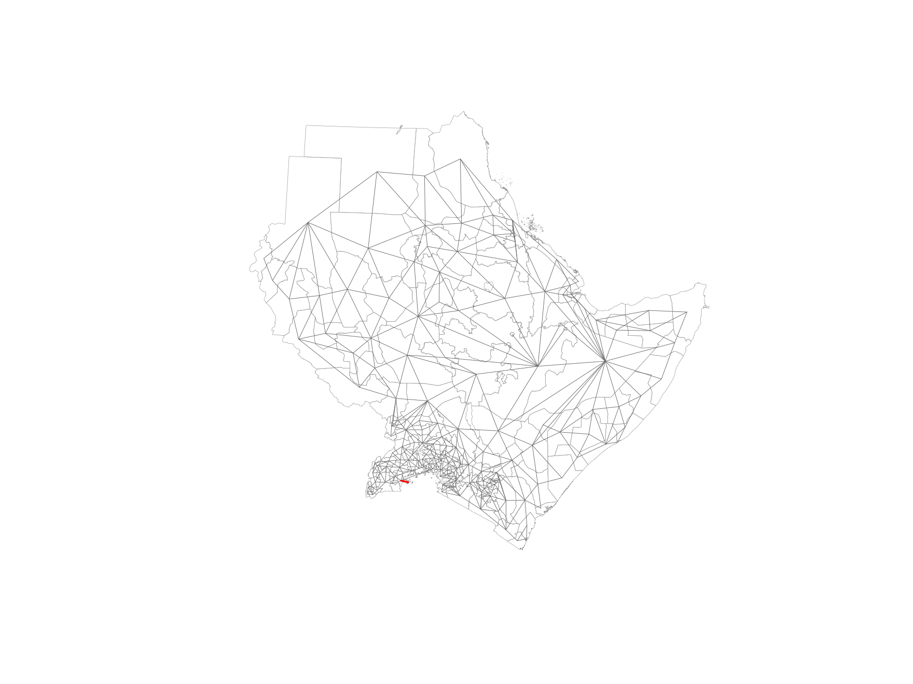
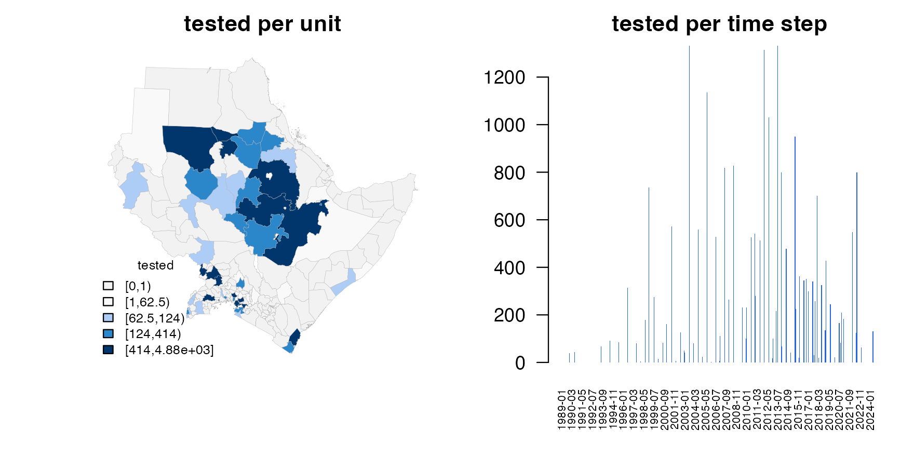
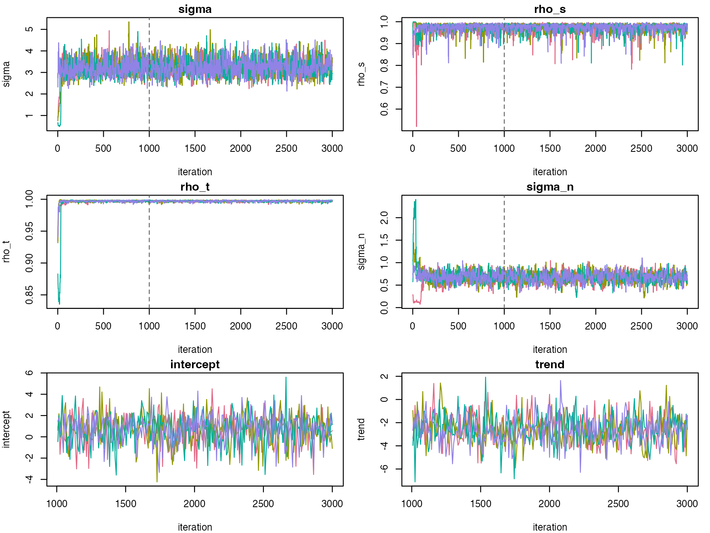
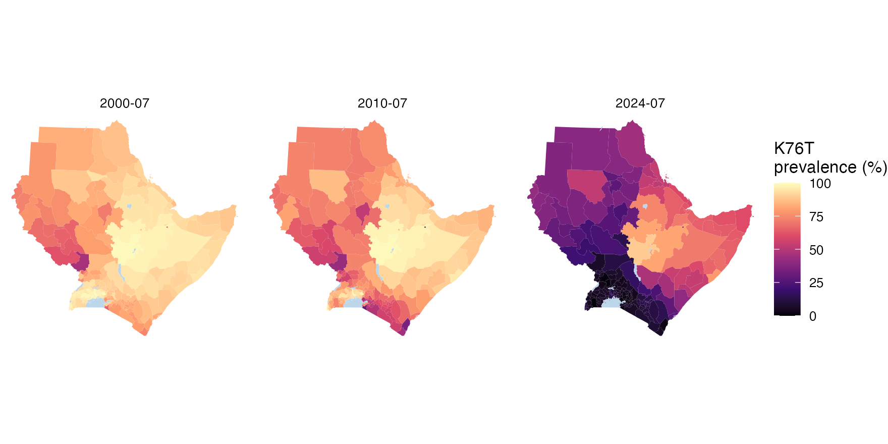
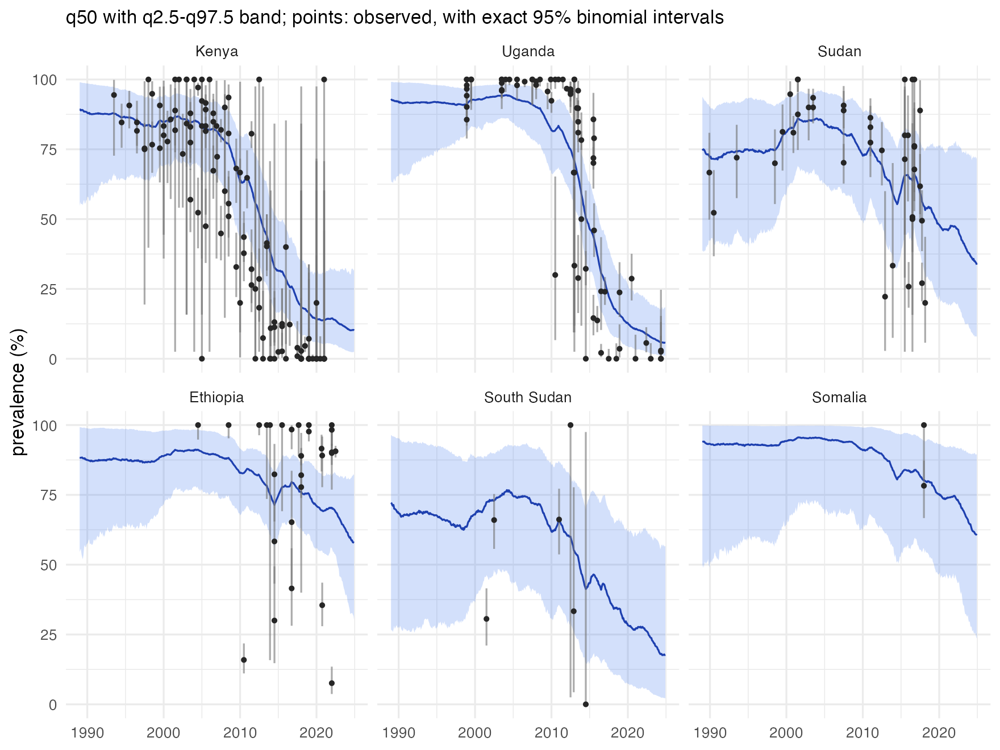
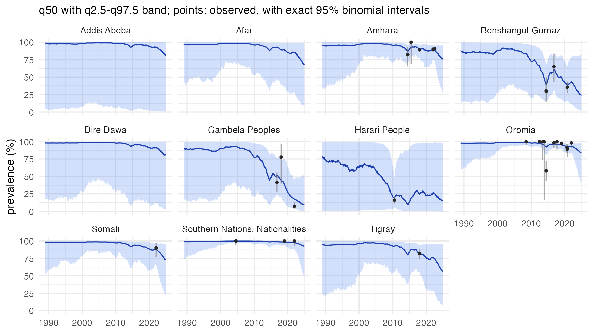
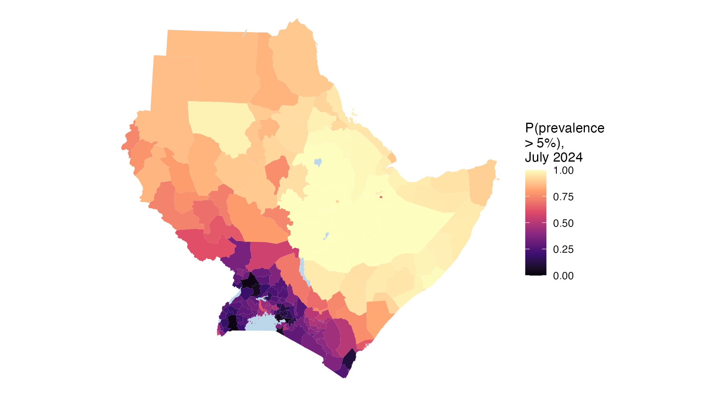
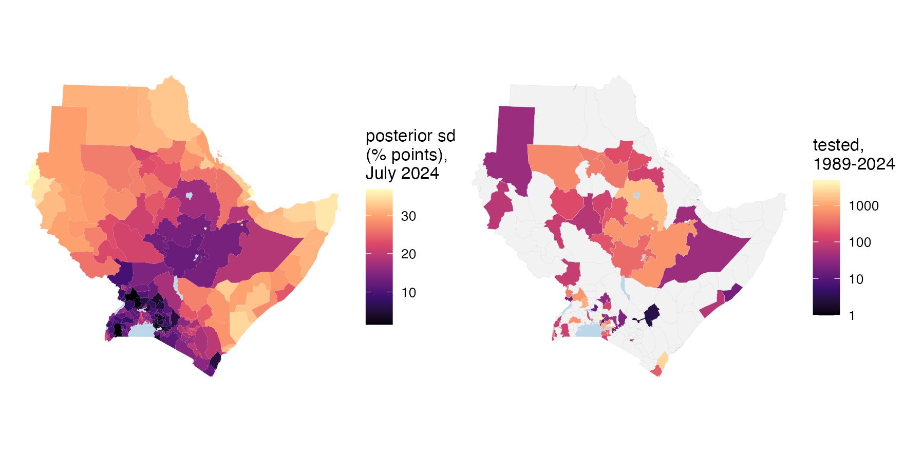

# 1. Mapping crt K76T in the Greater Horn of Africa

The *Plasmodium falciparum* crt K76T mutation is the main marker of
chloroquine resistance. Chloroquine was replaced as the first-line
treatment for falciparum malaria across East Africa between the late
1990s and the mid-2000s, and where it stopped being used the resistant
parasites lost their advantage. This tutorial maps K76T month by month
across the eight member states of IGAD (Djibouti, Eritrea, Ethiopia,
Kenya, Somalia, South Sudan, Sudan and Uganda) from 1989 to 2024, and
asks:

- how prevalence changed in each country, with honest uncertainty;
- where the chloroquine-sensitive parasite is now dominant;
- where the data are too thin to say.

``` r
library(stareal)
```

## 1. The data: a STAVE object

STAVE stores studies, surveys and variant counts. The public data set is
an R object of a little over 250 kB; reading it needs the [STAVE
package](https://github.com/mrc-ide/STAVE).

``` r
url <- paste0("https://github.com/IDEELResearch/scrub/raw/2d85d021efe1c93dc55300610d944c9fbaf4af1a/",
              "analysis/data-out/stave_data_2026.03.17.rds")
tmp <- tempfile(fileext = ".rds")
download.file(url, tmp, mode = "wb", quiet = TRUE)
stave <- suppressWarnings(readRDS(tmp))
stave
#> Studies: 578
#> Surveys: 3848
```

The prevalence of a variant comes from `get_prevalence()`. It counts
every survey that genotyped the codon, whatever format the study used,
including the surveys where the mutant was absent. Setting
`return_full = FALSE` drops any rows where the *denominator* is zero,
which is what we want here:

``` r
p <- stave$get_prevalence("crt:76:T", return_full = FALSE)
nrow(p)
#> [1] 2819
```

These are the surveys of every country in the data set. Section 3
selects those in the region of interest.

## 2. The spatial frame

The areas are the first-level administrative units of the eight
countries, from [GADM](https://gadm.org) version 4.1, downloaded with
the [geodata](https://cran.r-project.org/package=geodata) package.
GADM’s licence allows free academic and other non-commercial use but not
redistribution, so the boundaries are downloaded rather than shipped
with *stareal*. The low-resolution files (`resolution = 2`) are ample
for maps at this scale.

``` r
iso3 <- c("DJI", "ERI", "ETH", "KEN", "SOM", "SSD", "SDN", "UGA")
adm1 <- sf::st_as_sf(geodata::gadm(iso3, level = 1, path = tempdir(), version = "4.1", resolution = 2))
table(adm1$COUNTRY)
#> 
#>    Djibouti     Eritrea    Ethiopia       Kenya     Somalia South Sudan 
#>           6           6          11          47          18          10 
#>       Sudan      Uganda 
#>          18          58
```

Uganda’s first level in GADM is its districts, so it has many more units
than its neighbours.

**Lakes are not places where people live**, and GADM treats them
inconsistently. Uganda’s parts of Lakes Victoria and Albert are units of
their own, while Kenya’s and Ethiopia’s lakes are folded into the
surrounding units. Left in, a lake would get a prevalence of its own, or
stretch a lakeside unit across the water and make it a neighbour of
units on the far shore. So the large lakes are cut out of every unit,
using the public-domain lakes of [Natural
Earth](https://www.naturalearthdata.com), downloaded with the
[rnaturalearth](https://cran.r-project.org/package=rnaturalearth)
package. The cutting is done in an equal-area projection centred on the
region, which the frame then keeps for its distances. Note that this
step is simply a quirk of us using GADM 4.1 shapefiles - if you use your
own shapefile then this should hopefully not be needed.

``` r
lakes <- rnaturalearth::ne_download(scale = 10, type = "lakes", category = "physical",
                                    returnclass = "sf", destdir = tempdir())
crs <- "+proj=laea +lat_0=8 +lon_0=37 +units=m"          # equal-area, centred on the region
adm1 <- sf::st_make_valid(sf::st_transform(adm1, crs))
lakes <- sf::st_make_valid(sf::st_transform(lakes, crs))
lakes <- lakes[as.numeric(sf::st_area(lakes)) > 1e9, ]  # lakes over 1,000 km2
water <- sf::st_intersection(sf::st_union(lakes), sf::st_union(adm1))
adm1 <- sf::st_difference(adm1, water)
adm1 <- adm1[adm1$ENGTYPE_1 != "Water body", ]           # what is left of Uganda's lake units
```

Now we have a nice clean shapefile

``` r
class(adm1)
#> [1] "sf"         "data.frame"
dim(adm1)
#> [1] 172  12
```

[`areal_frame()`](https://mrc-ide.github.io/stareal/reference/areal_frame.md)
converts a shapefile into the elements needed by the model. It finds the
neighbours of every unit, links any islands to the nearest unit of the
same country, and computes the eigendecomposition of the graph that the
model needs. That is a one-off step, quick for a few hundred units. With
thousands of units, build the frame once and save it with
[`saveRDS()`](https://rdrr.io/r/base/readRDS.html).

``` r
fr <- areal_frame(adm1, id = "GID_1", groups = c(country = "COUNTRY"),
                  link_within = "country", verbose = FALSE)
fr
#> <stareal_frame> 172 units, 432 edges (mean 5.0 neighbours), 1 connected component
#>   built from: polygons
#>   island links added: 1
#>   groupings: country (8)
```

We can visualize the adjacency graph between areas:

``` r
plot(fr)
```



## 3. The surveys in the region

STAVE treats a survey’s coordinates, not its country name, as the
authoritative record of where it took place. Country names are stored as
free text making them inherently unstable - they vary in spelling, case,
special characters, and may be prone to mistakes. Latitude and longitude
are the fields intended for spatial selection, surveys are therefore
selected by location: those within 10 km of one of the units. Distances
are measured in the frame’s planar projection, `fr$crs_planar`. This is
the same rule that
[`areal_data()`](https://mrc-ide.github.io/stareal/reference/areal_data.md)
uses to assign a point just outside every polygon, such as a coastal
site, to the nearest unit.

``` r
pts <- sf::st_transform(sf::st_as_sf(p, coords = c("longitude", "latitude"), crs = 4326), fr$crs_planar)
units <- sf::st_transform(adm1, fr$crs_planar)
surveys <- p[lengths(sf::st_is_within_distance(pts, units, dist = 10000)) > 0, ]
nrow(surveys)
#> [1] 328
```

These are exactly the surveys in `igad_crt76t`, the example data that
ship with *stareal*:

``` r
all.equal(sort(surveys$survey_id), sort(igad_crt76t$survey_id))
#> [1] TRUE
```

## 4. Time, and the survey data

We want to draw inference in monthly steps from 1989 to 2024:

``` r
tf <- time_frame(1989, 2024, "month")
tf
#> <stareal_time> monthly steps, 1989-01 to 2024-12 (432 steps)
```

[`areal_data()`](https://mrc-ide.github.io/stareal/reference/areal_data.md)
puts each survey in a unit and a month, and pools surveys in the same
unit and month. A survey’s month is that of its `collection_day`: the
middle of its collection window, or the date the study gave. This is
where the areal frame, the time frame, and the survey data come
together.

``` r
d <- areal_data(surveys, fr, tf, y = "numerator", k = "denominator",
                coords = c("longitude", "latitude"), date = "collection_day")
#> 328 of 328 surveys used, pooled into 264 cells (print the result for the exclusions)
d
#> <stareal_data> 328 of 328 surveys used, pooled into 264 cells
#>   59 of 172 units and 74 of 432 time steps have data (0.36% of the 74,304 area-time cells)
#>   tested per cell: median 54, range 1-1,310; total 23,844 tested, 16,978 positive
#>   9 surveys snapped to the nearest unit (max 7.2 km)
```

We can produce a simple plot to see how data are distributed in space
and time:

``` r
plot(d)
```



The data are clumped in both space and time. Only 264 of the 74,304
unit-months have data. The model fills the gaps from neighbouring units
and months, and presents uncertainty as part of the answer.

## 5. Fitting

The defaults run four chains of 3,000 iterations, in parallel. This
example should take no more than a couple of minutes on a modern laptop:

``` r
fit <- fit_areal(d)
```

[`diagnose()`](https://mrc-ide.github.io/stareal/reference/diagnose.md)
checks the R-hat and effective sample size (ESS) of every parameter,
including the latent prevalence of every observed cell. We want small
R-hat, indicating the MCMC has converged, but large ESS, indicating it
has adequately explored the posterior:

``` r
diagnose(fit)
#> <stareal_fit summary> 264 observed cells; 4 chains, 2000 iterations after burn-in
#>   hyperparameters from the trace (8000 draws), fixed effects and cells from the 1000 stored draws
#> 
#>   variable   mean      sd   q2.5    q50  q97.5  rhat ess_bulk ess_tail
#>      sigma  3.250 0.37000  2.590  3.230  4.060 1.003     1209     2090
#>      rho_s  0.974 0.01870  0.926  0.979  0.993 1.003     1414     1874
#>      rho_t  0.997 0.00106  0.995  0.997  0.999 1.004     1353     2014
#>    sigma_n  0.668 0.11100  0.441  0.669  0.879 1.005      841     1108
#>  intercept  0.709 1.38000 -2.290  0.780  3.220 0.997     1098      993
#>      trend -2.570 1.22000 -4.990 -2.610 -0.168 1.001      841      864
#> 
#> acceptance after burn-in: centred 0.20, surrogate 0.21; 0.0179 s per iteration
#> latent cells: 264; R-hat over threshold in 0; bulk ESS median 957, min 450; max MCSE of the mean 0.84 (prevalence, %)
#> 
#>   theta R-hat (max)                 1  <= 1.05   ok
#>   beta R-hat (max)                  1  <= 1.05   ok
#>   latent R-hat (max)             1.02  <= 1.05   ok
#>   theta bulk ESS (min)            841  >= 400    ok
#>   beta bulk ESS (min)             841  >= 400    ok
#>   latent bulk ESS (median)        957  >= 100    ok
#> 
#> PASS
```

Every check passes. That is not guaranteed: sparse or mostly-zero data
mix more slowly (see [tutorial
2](https://mrc-ide.github.io/stareal/articles/k13-561h.md)). A
[`summary()`](https://rdrr.io/r/base/summary.html) of the fit shows some
more detail including parameter estimates, and a
[`plot()`](https://rdrr.io/r/graphics/plot.default.html) gives a visual
check of the MCMC behaviour:

``` r
summary(fit)
#> <stareal_fit summary> 264 observed cells; 4 chains, 2000 iterations after burn-in
#>   hyperparameters from the trace (8000 draws), fixed effects from the 1000 stored draws
#> 
#>   variable   mean      sd   q2.5    q50  q97.5  rhat ess_bulk ess_tail
#>      sigma  3.250 0.37000  2.590  3.230  4.060 1.003     1209     2090
#>      rho_s  0.974 0.01870  0.926  0.979  0.993 1.003     1414     1874
#>      rho_t  0.997 0.00106  0.995  0.997  0.999 1.004     1353     2014
#>    sigma_n  0.668 0.11100  0.441  0.669  0.879 1.005      841     1108
#>  intercept  0.709 1.38000 -2.290  0.780  3.220 0.997     1098      993
#>      trend -2.570 1.22000 -4.990 -2.610 -0.168 1.001      841      864
#> 
#> acceptance after burn-in: centred 0.20, surrogate 0.21; 0.0179 s per iteration
#> for every observed cell and a verdict, use diagnose()
```

``` r
plot(fit)
```



This is good enough for our preliminary analysis. For publishable
results, a longer run gives more draws in the tails of the intervals -
particularly important when calculating exceedance probabilities. With
`checkpoint_dir` set, an interrupted run picks up where it stopped when
the same call is run again (note, this line will take longer to run -
skip if you just want preliminary results):

``` r
fit <- fit_areal(d, control = list(n_iter = 20000, n_burn = 5000, n_store = 250, theta_thin = 10),
                 checkpoint_dir = "chains/crt76t")
```

How to read the parameters:

- `sigma` sets the size of the variation around the trend, on the logit
  scale.
- `rho_s` close to 1 means neighbouring units are strongly alike.
- `rho_t` is the correlation from one month to the next. Close to 1, as
  here, prevalence changes slowly.
- `sigma_n` is the scatter between unit-months, beyond what the field
  explains (different sites, sampling, methods).
- `intercept` is the logit prevalence at the middle of the window,
  before the field.
- `trend` is half the change in logit prevalence over the window, before
  the field. A strongly negative value is the regional decline.

## 6. Predicting the full surface

[`predict()`](https://rdrr.io/r/stats/predict.html) reconstructs the
prevalence of every unit in every month, once per posterior draw, and
aggregates each draw to the countries. Country estimates here are
unweighted means over their units; with population or parasite-burden
data you can give them as `weights`.

``` r
pr <- predict(fit, groups = "country", exceedance = 5)
pr
#> <stareal_pred> 172 areas x 432 time steps from 1000 posterior draws
#>   aggregated to: country (8) (equal weights)
#>   statistics: mean, sd, q2.5, q50, q97.5, p_gt_5
#>   tables: $area, $groups$country
```

Maps for three months, made with
[`sf::st_as_sf()`](https://r-spatial.github.io/sf/reference/st_as_sf.html),
which joins one month’s estimates to the polygons, with the lakes cut
out earlier drawn as water:

``` r
months <- c("2000-07", "2010-07", "2024-07")
m <- do.call(rbind, lapply(months, function(t) sf::st_as_sf(pr, time = t)))
ggplot(m) +
  geom_sf(aes(fill = mean), colour = NA) +
  geom_sf(data = sf::st_sf(water), fill = "#bcd6ea", colour = NA) +
  facet_wrap(~time) +
  scale_fill_viridis_c("K76T\nprevalence (%)", limits = c(0, 100), option = "magma") +
  theme_void()
```



We can also look at trends over time. The next plot gives country
trends, with the 95% interval as a shaded ribbon, and the data overlaid
for comparison (exact 95% binomial interval from raw survey data). The
data are from surveyed units only, while the band covers the whole
country, so the two need not agree where few units are surveyed.

``` r
plot(pr, group = "country", ids = c("Kenya", "Uganda", "Sudan", "Ethiopia", "South Sudan", "Somalia"))
```



Kenya and Uganda tell the clearest story. K76T was common, above 80%,
until the late 2000s, then fell, to around 10% by 2024. Sudan’s decline
is slower and less certain. Ethiopia is different: its surveys up to
2022 still find K76T in most infections. Ethiopia still treats *P.
vivax* malaria with chloroquine, a likely reason. After its last
surveys, the country’s band drifts down with the trend of the region as
a whole. The model has one trend for all eight countries, so it
extrapolates the region’s decline into a country that may not share it.
[Tutorial 3](https://mrc-ide.github.io/stareal/articles/covariates.md)
gives countries trends of their own. In Somalia, with two surveys, and
South Sudan, with six and none since 2014, the estimates lean on the
neighbours and the regional trend, and the bands are wide.

We can also dig into the trends within sub-national regions. For
example, the next plot shows trends for all 11 tier-one subdivisions of
Ethiopia:

``` r
ids <- sprintf("ETH.%s_1", 1:11)
plot(pr, ids = ids, labels = adm1$NAME_1[match(ids, adm1$GID_1)])
```



We see very different trends in the West (e.g. Gambela) compared with
the East (e.g. Oromia).

## 7. Probability statements, and where the data run out

The posterior answers questions directly. Where is K76T still above 5%?
[`predict()`](https://rdrr.io/r/stats/predict.html) was asked for that
probability with `exceedance = 5` (in percent, like every prevalence in
*stareal*), and reports it as `p_gt_5`:

``` r
m24 <- sf::st_as_sf(pr, time = "2024-07")
ggplot(m24) +
  geom_sf(aes(fill = p_gt_5), colour = NA) +
  geom_sf(data = sf::st_sf(water), fill = "#bcd6ea", colour = NA) +
  scale_fill_viridis_c("P(prevalence\n> 5%),\nJuly 2024", limits = c(0, 1), option = "magma") +
  theme_void()
```



The units by how sure the model is, country by country: probably above
5% (a probability over 0.9), probably below (under 0.1), or uncertain:

``` r
m24$call <- cut(m24$p_gt_5, c(0, 0.1, 0.9, 1), include.lowest = TRUE,
                labels = c("probably below", "uncertain", "probably above"))
table(m24$country, m24$call)
#>              
#>               probably below uncertain probably above
#>   Djibouti                 0         1              5
#>   Eritrea                  0         0              6
#>   Ethiopia                 0         2              9
#>   Kenya                    3        41              3
#>   Somalia                  0         1             17
#>   South Sudan              0        10              0
#>   Sudan                    0        14              4
#>   Uganda                   3        53              0
```

K76T is probably still above 5% across the Horn: in most units of
Ethiopia, Eritrea, Somalia and Djibouti. Ethiopia’s recent surveys find
it common, and its neighbours, with few or no surveys of their own,
borrow from them. In Kenya and Uganda, where it fell furthest, most
units are uncertain. Their prevalence, around 5 to 10%, sits close to
the threshold, and only 6 units in the whole region are probably below
it. A low threshold is a demanding question: saying with confidence that
prevalence is below 5% takes many recent surveys that find little.

Uncertainty is not uniform. The posterior standard deviation in July
2024, beside the total number tested in each unit over the whole period:

``` r
m24$tested <- tapply(pr$area$k, pr$area$id, sum)[m24$id]
m24$tested[m24$tested == 0] <- NA
g1 <- ggplot(m24) + geom_sf(aes(fill = sd), colour = NA) +
  geom_sf(data = sf::st_sf(water), fill = "#bcd6ea", colour = NA) +
  scale_fill_viridis_c("posterior sd\n(% points),\nJuly 2024", option = "magma") + theme_void()
g2 <- ggplot(m24) + geom_sf(aes(fill = tested), colour = "grey85", linewidth = 0.05) +
  geom_sf(data = sf::st_sf(water), fill = "#bcd6ea", colour = NA) +
  scale_fill_viridis_c("tested,\n1989-2024", trans = "log10", na.value = "grey95", option = "magma") +
  theme_void()
patchwork::wrap_plots(g1, g2)
```



The median standard deviation by country:

``` r
round(tapply(m24$sd, m24$country, median), 2)
#>    Djibouti     Eritrea    Ethiopia       Kenya     Somalia South Sudan 
#>       31.76       32.05       21.50       14.90       31.29       22.54 
#>       Sudan      Uganda 
#>       28.72       11.59
```

Where there are few or no surveys, as in Djibouti, Eritrea, Somalia and
much of Sudan, the median standard deviation is about 30 percentage
points, against 12 in Uganda and 15 in Kenya. A map of the posterior
mean alone would hide this.

## 8. Taking the results away

The tables are ordinary data frames, and the maps ordinary `sf` objects:

``` r
write.csv(pr$area, "crt76t_by_unit_month.csv", row.names = FALSE)
write.csv(pr$groups$country, "crt76t_by_country_month.csv", row.names = FALSE)
sf::st_write(sf::st_as_sf(pr, time = "2024-07"), "crt76t_2024-07.gpkg")
```

The posterior draws of the parameters and of every observed cell are
available for your own summaries with `posterior::as_draws_df(fit)`.

## What next

- [2. Rare and emerging
  markers](https://mrc-ide.github.io/stareal/articles/k13-561h.md): k13
  R561H in East Africa, where most surveys find nothing.
- [Method](https://mrc-ide.github.io/stareal/articles/method.md): what
  the model is, and how it is fitted.
