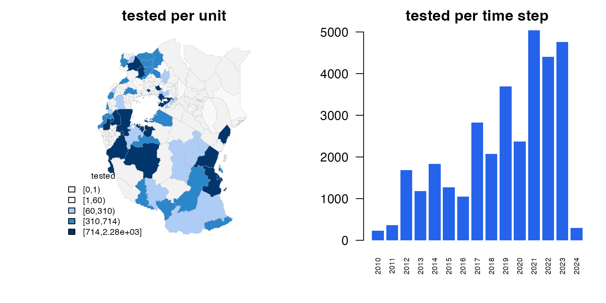
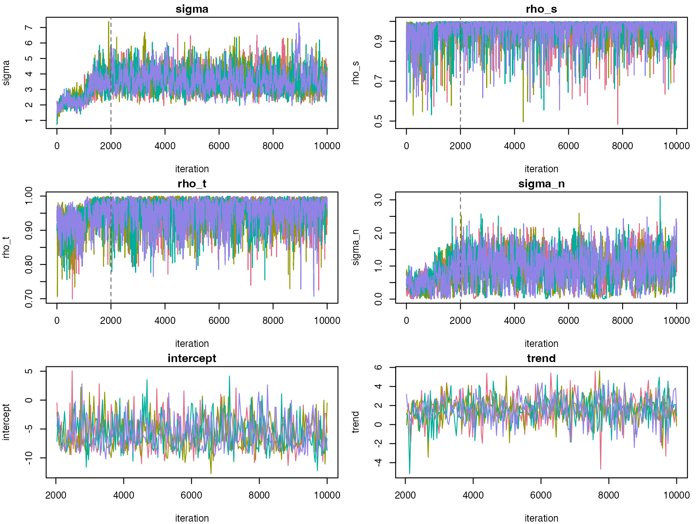
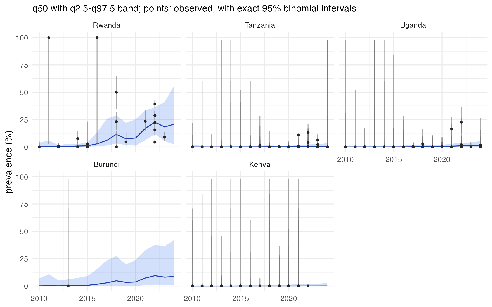
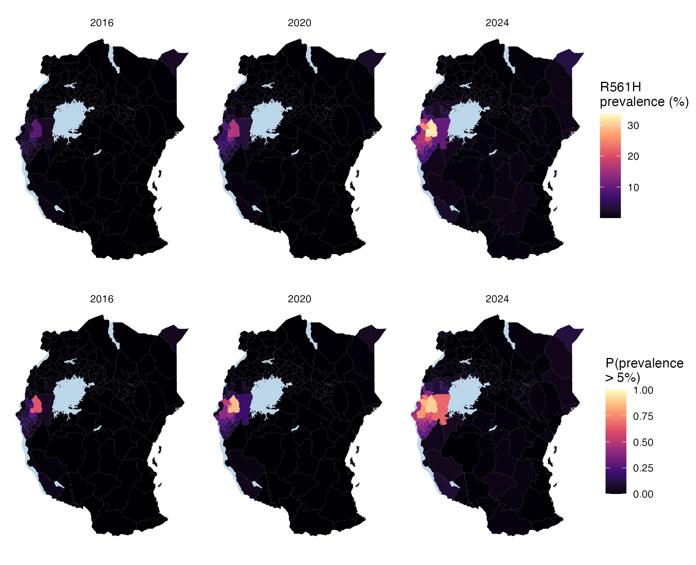

# 2. Rare and emerging markers: k13 R561H in East Africa

The kelch13 R561H mutation confers artemisinin partial resistance. In
the data used here it appears first in Rwanda, and later in
north-western Tanzania and south-western Uganda. A marker like this
differs from crt K76T in [tutorial
1](https://mrc-ide.github.io/stareal/articles/crt76t.md) in three ways:

- **most surveys find nothing**, so the data are mostly zeros;
- **the signal is local and recent**: a few areas, in the last decade;
- **the questions are about thresholds**: where is prevalence probably
  above a level that matters for policy?

This tutorial maps R561H across five countries around Lake Victoria:
Rwanda, Burundi, Tanzania, Uganda and Kenya. It moves quickly through
the steps of tutorial 1 and dwells on what changes.

``` r
library(stareal)
```

## 1. The data

The same STAVE object as in tutorial 1, and the prevalence of R561H:

``` r
url <- paste0("https://github.com/IDEELResearch/scrub/raw/2d85d021efe1c93dc55300610d944c9fbaf4af1a/",
              "analysis/data-out/stave_data_2026.03.17.rds")
tmp <- tempfile(fileext = ".rds")
download.file(url, tmp, mode = "wb", quiet = TRUE)
stave <- suppressWarnings(readRDS(tmp))
p <- stave$get_prevalence("k13:561:H")
p <- p[p$denominator > 0, ]
```

Most surveys find no R561H. Those zeros are what tell the model where
the mutation is absent, so they must be kept. `get_prevalence()` keeps
them: it counts every survey that genotyped codon 561.

The frame is the first-level units of the five countries, from GADM,
with the large lakes cut out as in tutorial 1, here in an equal-area
projection centred on Lake Victoria. The surveys are selected by
location, as in tutorial 1:

``` r
adm1 <- sf::st_as_sf(geodata::gadm(c("RWA", "BDI", "TZA", "UGA", "KEN"), level = 1, path = tempdir(),
                                   version = "4.1", resolution = 2))
lakes <- rnaturalearth::ne_download(scale = 10, type = "lakes", category = "physical",
                                    returnclass = "sf", destdir = tempdir())
crs <- "+proj=laea +lat_0=-3 +lon_0=34 +units=m"
adm1 <- sf::st_make_valid(sf::st_transform(adm1, crs))
lakes <- sf::st_make_valid(sf::st_transform(lakes, crs))
lakes <- lakes[as.numeric(sf::st_area(lakes)) > 1e9, ]
water <- sf::st_intersection(sf::st_union(lakes), sf::st_union(adm1))
adm1 <- sf::st_difference(adm1, water)
adm1 <- adm1[adm1$ENGTYPE_1 != "Water body", ]           # what is left of Uganda's lake units
fr <- areal_frame(adm1, id = "GID_1", groups = c(country = "COUNTRY"), link_within = "country",
                  verbose = FALSE)
pts <- sf::st_transform(sf::st_as_sf(p, coords = c("longitude", "latitude"), crs = 4326), fr$crs_planar)
surveys <- p[lengths(sf::st_is_within_distance(pts, adm1, dist = 10000)) > 0, ]
```

Yearly steps from 2010. A rare marker has few positive surveys, and a
year pools them into better-informed cells; the emergence unfolds over
years, not months.

``` r
tf <- time_frame(2010, 2024, "year")
d <- areal_data(surveys, fr, tf, y = "numerator", k = "denominator",
                coords = c("longitude", "latitude"), date = "collection_day")
#> 1591 of 1637 surveys used, pooled into 311 cells (print the result for the exclusions)
d
#> <stareal_data> 1,591 of 1,637 surveys used, pooled into 311 cells
#>   75 of 156 units and 15 of 15 time steps have data (13.29% of the 2,340 area-time cells)
#>   tested per cell: median 71, range 1-1,033; total 33,079 tested, 820 positive
#>   12 surveys snapped to the nearest unit (max 9.1 km)
#>   excluded:
#>         46  outside time window
```

By country, from the units the surveys fall in:

``` r
used <- d$surveys[is.na(d$surveys$.excluded), ]
country <- fr$groups$country[match(used$.id, fr$ids)]
tab <- data.frame(surveys = c(table(country)),
                  with_R561H = c(tapply(used$numerator > 0, country, sum)),
                  positive = c(tapply(used$numerator, country, sum)),
                  tested = c(tapply(used$denominator, country, sum)))
tab
#>          surveys with_R561H positive tested
#> Burundi        4          0        0      4
#> Kenya         93          0        0   5223
#> Rwanda       114         85      577   4099
#> Tanzania    1181         24      216  14871
#> Uganda       199          6       27   8882
```

``` r
plot(d)
```



Rwanda has few of the surveys but most of the R561H: it was found in 85
of Rwanda’s 114 surveys. Tanzania has by far the most surveys, and finds
R561H in 24. Uganda finds it in 6 and Kenya in none. Burundi has only 4
people tested, all in 2013.

## 2. Fitting

A first fit with the defaults:

``` r
pilot <- fit_areal(d)
diagnose(pilot)$checks
#>                      check      value threshold direction  pass
#> 1        theta R-hat (max)   1.044571      1.05        <=  TRUE
#> 2         beta R-hat (max)   1.000881      1.05        <=  TRUE
#> 3       latent R-hat (max)   1.019940      1.05        <=  TRUE
#> 4     theta bulk ESS (min) 130.299220    400.00        >= FALSE
#> 5      beta bulk ESS (min) 560.638339    400.00        >=  TRUE
#> 6 latent bulk ESS (median) 513.450082    100.00        >=  TRUE
```

It fails: the hyperparameters’ effective sample size is well below 400.
Mostly-zero data say little about each cell, and the hyperparameters mix
slowly. The remedy is a longer run, here more than three times the
default length:

``` r
fit <- fit_areal(d, control = list(n_iter = 10000, n_burn = 2000))
diagnose(fit)$checks
#>                      check      value threshold direction pass
#> 1        theta R-hat (max)   1.004204      1.05        <= TRUE
#> 2         beta R-hat (max)   1.001666      1.05        <= TRUE
#> 3       latent R-hat (max)   1.008650      1.05        <= TRUE
#> 4     theta bulk ESS (min) 549.766531    400.00        >= TRUE
#> 5      beta bulk ESS (min) 813.636127    400.00        >= TRUE
#> 6 latent bulk ESS (median) 932.065563    100.00        >= TRUE
summary(fit)
#> <stareal_fit summary> 311 observed cells; 4 chains, 8000 iterations after burn-in
#>   hyperparameters from the trace (32000 draws), fixed effects from the 1000 stored draws
#> 
#>   variable   mean     sd     q2.5    q50 q97.5  rhat ess_bulk ess_tail
#>      sigma  3.620 0.6720   2.5000  3.560 5.100 1.003      875     1336
#>      rho_s  0.969 0.0429   0.8510  0.986 0.999 1.003     1778     3113
#>      rho_t  0.959 0.0347   0.8700  0.967 0.998 1.002      923      854
#>    sigma_n  0.972 0.4550   0.0961  1.000 1.830 1.004      550      602
#>  intercept -5.800 2.8300 -10.0000 -6.380 0.544 1.000      866      906
#>      trend  1.610 1.3600  -1.3300  1.640 4.140 1.002      814      927
#> 
#> acceptance after burn-in: centred 0.18, surrogate 0.21; 0.0122 s per iteration
#> for every observed cell and a verdict, use diagnose()
```

``` r
plot(fit)
```



The longer run passes every check. Compared with crt K76T:

- The `intercept` is the logit prevalence in the middle of the window
  (2017), before the field: about -5.8, or 0.3%. That is the regional
  baseline: the mutation is absent from most of the region.
- The `trend` is positive but uncertain: its interval runs from -1.3 to
  4.1. The rise is local, in and around Rwanda, so the field carries it
  rather than a trend for the whole region.
- `sigma` is large. The field has to carry a local emergence: tens of
  percent in a few units, against near zero in most.
- `sigma_n` is large too. Unit-years depart from the smooth field by
  more than it can explain: neighbouring units, or one unit in
  consecutive years, can differ sharply.

## 3. Where has R561H spread?

The probability that prevalence exceeds 5% is asked for with
`exceedance`:

``` r
pr <- predict(fit, groups = "country", exceedance = 5)
```

Country trends, with the surveys and their exact binomial intervals:

``` r
plot(pr, group = "country", ids = c("Rwanda", "Tanzania", "Uganda", "Burundi", "Kenya"))
```



``` r
subset(pr$groups$country, time %in% c("2016", "2020", "2024"),
       select = c(id, time, mean, q50, q2.5, q97.5, p_gt_5))
#>          id time        mean          q50         q2.5      q97.5 p_gt_5
#> 7   Burundi 2016  3.19260214  1.601201681 0.1043682752 15.4664733  0.196
#> 11  Burundi 2020  5.83074902  3.644803296 0.2309945257 23.6836101  0.400
#> 15  Burundi 2024 12.39698838  8.645963297 0.5721374073 42.2599464  0.688
#> 22    Kenya 2016  0.06954643  0.009204901 0.0003075997  0.6911028  0.000
#> 26    Kenya 2020  0.11371087  0.019572104 0.0005814578  1.2363485  0.000
#> 30    Kenya 2024  0.38161310  0.102154970 0.0027721661  2.5796236  0.006
#> 37   Rwanda 2016  3.88210348  2.828306238 0.6311529754 13.2366764  0.234
#> 41   Rwanda 2020  9.51357452  8.172432201 1.1962932219 25.2979897  0.749
#> 45   Rwanda 2024 23.06001533 20.733194215 2.2885733267 55.9621061  0.917
#> 52 Tanzania 2016  0.14298451  0.063021593 0.0081462818  0.7549538  0.000
#> 56 Tanzania 2020  0.25019933  0.162824406 0.0210906257  1.0291724  0.000
#> 60 Tanzania 2024  0.88564742  0.582105399 0.0794008100  3.3416102  0.010
#> 67   Uganda 2016  0.21005359  0.100982984 0.0142825687  1.1925967  0.000
#> 71   Uganda 2020  0.44504366  0.275035790 0.0308965064  1.9133964  0.000
#> 75   Uganda 2024  1.60333216  1.167498635 0.1425033964  5.3147529  0.035
```

Maps of the posterior mean, and of the probability that prevalence
exceeds 5%, with the lakes drawn as water:

``` r
m <- do.call(rbind, lapply(c("2016", "2020", "2024"), function(y) sf::st_as_sf(pr, time = y)))
lake <- geom_sf(data = sf::st_sf(water), fill = "#bcd6ea", colour = NA)
g1 <- ggplot(m) + geom_sf(aes(fill = mean), colour = NA) + lake + facet_wrap(~time) +
  scale_fill_viridis_c("R561H\nprevalence (%)", option = "magma") + theme_void()
g2 <- ggplot(m) + geom_sf(aes(fill = p_gt_5), colour = NA) + lake + facet_wrap(~time) +
  scale_fill_viridis_c("P(prevalence\n> 5%)", limits = c(0, 1), option = "magma") + theme_void()
patchwork::wrap_plots(g1, g2, ncol = 1)
```



In 2016 the probability of exceeding 5% is moderate at most, in Rwanda.
By 2020 it is high across much of Rwanda. By 2024 it reaches across the
borders, into north-western Tanzania, south-western Uganda and northern
Burundi.

Which units are more likely than not above 5% in 2024, and what data
stand behind each?

``` r
hot <- subset(pr$area, time == "2024" & p_gt_5 > 0.5)
hot$name <- adm1$NAME_1[match(hot$id, adm1$GID_1)]
hot$tested <- tapply(pr$area$k, pr$area$id, sum)[hot$id]     # over all years
hot$positive <- tapply(pr$area$y, pr$area$id, sum)[hot$id]
hot <- hot[order(-hot$p_gt_5), ]
hot[, c("name", "country", "mean", "q2.5", "q97.5", "p_gt_5", "tested", "positive")]
#>                  name  country      mean       q2.5    q97.5 p_gt_5 tested
#> 45      Iburasirazuba   Rwanda 31.989402 1.91191200 80.72316  0.900   1077
#> 75   Umujyi wa Kigali   Rwanda 33.622484 1.12008879 87.05440  0.896   1016
#> 15       Amajyaruguru   Rwanda 25.265308 1.00150174 77.20634  0.851    564
#> 30          Amajyepfo   Rwanda 16.218159 0.99667205 55.16197  0.780    900
#> 975            Kabale   Uganda 15.417508 0.59382306 61.85804  0.709    236
#> 420            Kagera Tanzania  9.895555 0.67032644 38.32712  0.662   2285
#> 225           Kirundo  Burundi 22.880557 0.14521316 89.26553  0.630      0
#> 270           Muyinga  Burundi 15.606969 0.11914268 76.45788  0.552      0
#> 1185           Kisoro   Uganda 17.054202 0.02495561 87.41720  0.520      1
#> 300             Ngozi  Burundi 15.377510 0.08636639 82.67591  0.518      0
#>      positive
#> 45         84
#> 75        267
#> 15        162
#> 30         47
#> 975        23
#> 420       203
#> 225         0
#> 270         0
#> 1185        0
#> 300         0
```

The table says two different things:

- **Some rest on data**, with a hundred or more tested: Iburasirazuba,
  Umujyi wa Kigali, Amajyaruguru, Amajyepfo, Kabale, Kagera. These are
  Rwanda’s provinces, and the units across its borders where R561H has
  been found.
- **Some have no surveys at all**: Kirundo, Muyinga, Ngozi. Their
  probabilities come from their neighbours.

With a rare marker, a map of the mean or of an exceedance probability
shows where the model cannot rule the marker out as much as where it is.
Read it with the map of the data and the intervals.

## 4. What the model assumes, and when to doubt the map

- **Neighbours fill the gaps.** The field is smooth in space, so a unit
  with no surveys borrows from those around it. Burundi lies between
  Rwanda and Kagera, and has 4 people tested, all in 2013. Its mean
  reaches 12% by 2024, with an interval from 0.6% to 42%. That is not a
  finding about Burundi. It says that its neighbours’ data cannot rule
  R561H out there.
- **One variance for the whole region.** The field is stationary: the
  same `sigma`, `rho_s` and `rho_t` in every area and year. An emergence
  is a local, growing departure, and the model accommodates it with a
  large `sigma`. That variance then applies everywhere, which is why
  unsurveyed units have such wide intervals.
- **After the last survey.** Rwanda’s surveys stop in 2023 in these
  data, so 2024 there is extrapolated, and its interval widens.
- **Where the surveys were made.** Studies of an emerging marker are
  often sited where resistance is suspected, for example after treatment
  failures. The model assumes that survey locations tell it nothing
  about prevalence. If studies chase the mutation, the surveyed units
  overstate their neighbours.
- **A zero is worth its sample size.** 0 of 50 is not unusual when
  prevalence is 5%: it happens 8% of the time. The long grey bars in the
  country plot are surveys of one or a few infections: they say almost
  nothing. The binomial likelihood weighs each zero by its denominator,
  but many small zeros do not prove absence.

## What next

- [3.
  Covariates](https://mrc-ide.github.io/stareal/articles/covariates.md):
  explaining variation with data on the areas and the time steps.
- [Method](https://mrc-ide.github.io/stareal/articles/method.md): how
  the sampler copes with mostly-zero data.
