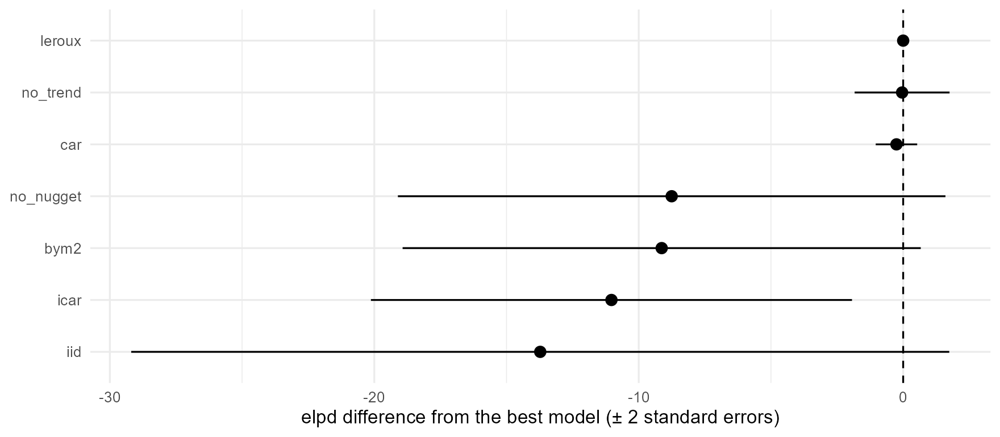

# 4. Choosing a model

The model of [tutorial
1](https://mrc-ide.github.io/stareal/articles/crt76t.md) made three
choices without comment: a Leroux prior in space, a linear trend in
time, and a nugget for the scatter between surveys. Each could have been
made differently. This tutorial uses the same crt K76T data to show how
to:

- choose another spatial prior;
- switch parts of the model off, or hold a parameter at a value;
- add a main effect in time, so that the regional curve can bend;
- score each fit by how well it predicts the data it was not given, with
  [`loo()`](https://mrc-ide.github.io/stareal/reference/loo.stareal_fit.md),
  and line the fits up with
  [`compare_models()`](https://mrc-ide.github.io/stareal/reference/compare_models.md).

``` r

library(stareal)
```

## 1. The data

As in tutorial 1:

``` r

iso3 <- c("DJI", "ERI", "ETH", "KEN", "SOM", "SSD", "SDN", "UGA")
adm1 <- sf::st_as_sf(geodata::gadm(iso3, level = 1, path = tempdir(), version = "4.1", resolution = 2))
lakes <- rnaturalearth::ne_download(scale = 10, type = "lakes", category = "physical",
                                    returnclass = "sf", destdir = tempdir())
crs <- "+proj=laea +lat_0=8 +lon_0=37 +units=m"
adm1 <- sf::st_make_valid(sf::st_transform(adm1, crs))
lakes <- sf::st_make_valid(sf::st_transform(lakes, crs))
lakes <- lakes[as.numeric(sf::st_area(lakes)) > 1e9, ]
water <- sf::st_intersection(sf::st_union(lakes), sf::st_union(adm1))
adm1 <- sf::st_difference(adm1, water)
adm1 <- adm1[adm1$ENGTYPE_1 != "Water body", ]           # what is left of Uganda's lake units
fr <- areal_frame(adm1, id = "GID_1", groups = c(country = "COUNTRY"), link_within = "country",
                  verbose = FALSE)
tf <- time_frame(1989, 2024, "month")
d <- areal_data(igad_crt76t, fr, tf, y = "positive", k = "tested",
                coords = c("longitude", "latitude"), date = "collection_day", verbose = FALSE)
```

## 2. Five spatial priors

At each time step, the field is given a prior on the adjacency graph:
how alike neighbouring units should be. `fit_areal(spatial = )` offers
five. All of them have a scale, `sigma`, and all but two a parameter
`rho_s` for the strength of spatial dependence, with `rho_s = 0` meaning
independent units. In plain words:

- **`"leroux"`**, the default. Each unit is a compromise between its
  neighbours and its own independent value, and `rho_s` sets the
  balance: near 1, neighbours are strongly alike.
- **`"bym2"`**: the field is the sum of a smooth part and an independent
  part. `sigma` is roughly the field’s standard deviation in any one
  unit, and `rho_s` is the share of its variance in the smooth part. It
  is the same idea as Leroux, parameterised so that the two numbers are
  easier to read and to give priors to. **`rho_s` does not mean the same
  as in Leroux**, so the two fits’ values are not comparable.
- **`"car"`**, the proper CAR. Each unit is drawn towards `rho_s` times
  the mean of its neighbours. Units with fewer neighbours, often on
  borders and coasts, vary more.
- **`"iid"`**: independent units, Leroux with `rho_s` fixed at 0. A unit
  learns nothing from its neighbours, only from its own surveys in
  nearby months. A unit never surveyed gets the regional mean, from the
  trend, and a wide interval.
- **`"icar"`**, the intrinsic CAR: Leroux with `rho_s` fixed at 1, the
  strongest smoothing. **The field then sums to zero over the units at
  every time step.** It can move one region up and another down, but not
  the whole map, so the region’s level and its changes over time come
  from the fixed effects alone. Here, that is one straight line on the
  logit scale.

The formulas are on the
[Method](https://mrc-ide.github.io/stareal/articles/method.html#spatial-priors)
page. All five cost the same to fit. With the default settings, each fit
takes about as long as tutorial 1’s:

``` r

fits <- list(
  leroux = fit_areal(d),
  bym2   = fit_areal(d, spatial = "bym2"),
  car    = fit_areal(d, spatial = "car"),
  iid    = fit_areal(d, spatial = "iid"),
  icar   = fit_areal(d, spatial = "icar")
)
sapply(fits, function(f) diagnose(f)$pass)
#> leroux   bym2    car    iid   icar 
#>   TRUE   TRUE   TRUE  FALSE   TRUE
```

The iid fit fails
[`diagnose()`](https://mrc-ide.github.io/stareal/reference/diagnose.md)
at the default length:

``` r

subset(summary(fits$iid)$table, select = c(variable, mean, q2.5, q97.5, rhat, ess_bulk))
#>    variable       mean         q2.5      q97.5      rhat  ess_bulk
#> 1     sigma  2.5726047  2.111745660  3.1373310 1.0046295 1124.9427
#> 2     rho_t  0.9943321  0.990038308  0.9973716 1.0038413  825.5162
#> 3   sigma_n  0.4109566  0.006037493  0.7644747 1.0412713  118.5460
#> 4 intercept  1.5458714  0.877584756  2.2848114 1.0012610 1011.9314
#> 5     trend -3.8673249 -4.947927191 -2.7801337 0.9978094  941.9405
```

The nugget’s effective sample size is low. With independent units, the
field and the nugget are both independent from one unit to the next, and
only the field’s memory from month to month tells them apart. As in
[tutorial 2](https://mrc-ide.github.io/stareal/articles/k13-561h.md),
the remedy is a longer run:

``` r

fits$iid <- fit_areal(d, spatial = "iid", control = list(n_iter = 10000, n_burn = 2000))
diagnose(fits$iid)$pass
#> [1] TRUE
```

Before any scores, compare what the priors make of the data. The
clearest difference is in the trend:

``` r

coef_of <- function(f, v) unlist(subset(summary(f)$table, variable == v, c(mean, q2.5, q97.5)))
round(t(sapply(fits, coef_of, "trend")), 2)
#>         mean  q2.5 q97.5
#> leroux -2.57 -4.99 -0.17
#> bym2   -3.76 -4.69 -2.79
#> car    -2.45 -4.66  0.04
#> iid    -3.85 -4.92 -2.76
#> icar   -3.87 -4.82 -2.97
```

Under Leroux and the proper CAR, the trend is uncertain: its interval
runs from about -5 to -0.2. Under BYM2, iid and ICAR it is steeper and
much better determined, at about -3.9. The reason is the field’s
region-wide component. With `rho_s` near 1, as here, the Leroux and
proper CAR fields can move the whole region up or down together, and
that component bends the regional curve away from the straight line of
the trend. The other three priors have almost no region-wide component
(ICAR has none at all), so the regional curve is the trend: a straight
line on the logit scale, which the data then pin down. The decline of
K76T need not have been a straight line, so the difference matters.
Section 5 asks which the data prefer.

## 3. Switching parts of the model off

The other parts of the model are switched off in the call:

- **No nugget**: `nugget = FALSE`. Every difference between surveys must
  then be explained by the smooth field.
- **No trend**: `formula = ~ 1`, an intercept only. The field must then
  carry the region-wide decline as well as the local departures from it.
- **A parameter held at a value**: `fixed`, a list of values for any of
  `sigma`, `rho_s`, `rho_t` and `sigma_n`. With `rho_t = 0`, the field
  has no memory from one month to the next: each month’s map is
  independent of the last, apart from the trend.

``` r

fits$no_nugget <- fit_areal(d, nugget = FALSE)
fits$no_trend  <- fit_areal(d, formula = ~ 1)
fits$rho_t_0   <- fit_areal(d, fixed = list(rho_t = 0), control = list(n_iter = 10000, n_burn = 2000))
sapply(fits[c("no_nugget", "no_trend", "rho_t_0")], function(f) diagnose(f)$pass)
#> no_nugget  no_trend   rho_t_0 
#>      TRUE      TRUE      TRUE
summary(fits$rho_t_0)
#> <stareal_fit summary> 264 observed cells; 4 chains, 8000 iterations after burn-in
#>   hyperparameters from the trace (32000 draws), fixed effects from the 1000 stored draws
#> 
#>   variable   mean     sd   q2.5    q50  q97.5  rhat ess_bulk ess_tail
#>      sigma  2.590 0.5020  1.630  2.590  3.580 1.002     1653     1225
#>      rho_s  0.971 0.0245  0.920  0.976  0.991 1.001     3491     4683
#>    sigma_n  1.380 0.4610  0.191  1.440  2.110 1.003      852      294
#>  intercept  1.520 0.2670  0.981  1.510  2.070 1.002      987      987
#>      trend -3.190 0.5640 -4.260 -3.190 -2.100 1.001      975      894
#> 
#> acceptance after burn-in: centred 0.22, surrogate 0.22; 0.0171 s per iteration
#> for every observed cell and a verdict, use diagnose()
```

A fixed parameter is not sampled, so it is missing from the summary, the
trace plots and
[`diagnose()`](https://mrc-ide.github.io/stareal/reference/diagnose.md).
The `rho_t = 0` fit is given the longer run from the start. Without
memory in time, the field and the nugget are hard to tell apart, as for
the iid prior: only the field’s correlation in space separates them, and
the default length is not enough.

## 4. Scoring a fit: `loo()`

[`diagnose()`](https://mrc-ide.github.io/stareal/reference/diagnose.md)
says whether a fit has converged, not whether its model is good. A model
is good if it predicts data it has not seen. Leave-one-out
cross-validation asks that of each observed cell (an area in a month,
all its surveys together): leave the cell out, fit the rest, and score
the cell’s surveys against the prediction. Done exactly, that is 264
refits.
[`loo()`](https://mrc-ide.github.io/stareal/reference/loo.stareal_fit.md)
approximates it from the one fit, in seconds:

``` r

l <- loo(fits$leroux)
l
#> <stareal_loo> integrated PSIS-LOO over 264 observed cells, 1000 draws
#>   elpd_loo -715.4 (se 28.8); p_loo 29.1; 1 cell with Pareto k > 0.67
```

How to read it:

- **`elpd_loo`** is the expected log predictive density: the sum over
  the cells of the log probability that the model, without the cell,
  gives to its surveys. Higher is better. On its own it means little. It
  is for comparing models fitted to the same data.
- **`p_loo`** is the effective number of parameters. The model has a
  latent value for each of 264 cells and six parameters, but the prior
  ties them together, so the model is about as flexible as one with 29
  free parameters.
- **Pareto k** is a check of the approximation in each cell. Above the
  threshold, that cell’s estimate is unreliable. A few such cells are
  normal: they are cells unlike the rest, whose own surveys carry most
  of the information about them. Many would call for exact
  cross-validation, with
  [`crossval()`](https://mrc-ide.github.io/stareal/reference/crossval.md).

The cells’ scores are in `l$cells`. The worst-predicted cells are the
surveys that disagree with their neighbours and their own unit’s past:

``` r

head(l$cells[order(l$cells$elpd_loo), c("id", "time", "y", "k", "elpd_loo", "pareto_k")])
#>           id    time   y   k   elpd_loo  pareto_k
#> 19   ETH.8_1 2014-07  28  48 -11.211953 0.7364905
#> 195  UGA.2_1 2013-07 485 599  -8.380723 0.5070969
#> 14   ETH.7_1 2010-07  31 195  -6.895350 0.1341652
#> 146  SSD.1_1 2001-07  26  85  -6.565051 0.4990686
#> 254 UGA.56_1 2010-01 206 223  -6.344417 0.5544979
#> 157  SDN.2_1 2000-12 119 147  -6.295725 0.6193091
```

[`loo()`](https://mrc-ide.github.io/stareal/reference/loo.stareal_fit.md)
integrates each cell’s own latent value out before the importance
sampling (the
[Method](https://mrc-ide.github.io/stareal/articles/method.html#leave-one-out-from-one-fit)
page has the details). Plain PSIS-LOO, as in the `loo` package, is
unstable for models like this one. The result is still a `loo` object,
so the `loo` package’s tools, such as
[`loo::loo_compare()`](https://mc-stan.org/loo/reference/loo_compare.html),
work on it.

## 5. Comparing models

[`compare_models()`](https://mrc-ide.github.io/stareal/reference/compare_models.md)
puts the fits side by side, best first. It computes
[`loo()`](https://mrc-ide.github.io/stareal/reference/loo.stareal_fit.md)
for each, and compares them cell by cell:

``` r

cmp <- do.call(compare_models, fits)
cmp[, c("model", "spatial", "nugget", "pass", "elpd_loo", "elpd_diff", "se_diff", "p_loo", "n_k_high")]
#>       model           spatial nugget pass  elpd_loo    elpd_diff    se_diff
#> 1    leroux            leroux   TRUE TRUE -715.4092    0.0000000  0.0000000
#> 2  no_trend            leroux   TRUE TRUE -715.4497   -0.0404925  0.8974943
#> 3       car               car   TRUE TRUE -715.6631   -0.2538508  0.3918301
#> 4 no_nugget            leroux  FALSE TRUE -724.1636   -8.7543908  5.1765789
#> 5      bym2              bym2   TRUE TRUE -724.5413   -9.1320750  4.8986038
#> 6      icar              icar   TRUE TRUE -726.4409  -11.0316524  4.5480826
#> 7       iid               iid   TRUE TRUE -729.1339  -13.7246879  7.7340137
#> 8   rho_t_0 leroux, rho_t = 0   TRUE TRUE -851.3946 -135.9853872 14.3258921
#>       p_loo n_k_high
#> 1 29.117685        1
#> 2 29.306126        3
#> 3 29.019037        4
#> 4 55.568991       15
#> 5 30.788471        4
#> 6 27.862866        3
#> 7 33.753705        6
#> 8  9.473417        1
```

`elpd_diff` is each model’s score minus the best’s, and `se_diff` its
standard error. Most of the variation in a cell’s score is between
cells: some surveys are hard to predict for any model. Comparing cell by
cell removes it, so `se_diff` is much smaller than the standard error of
either score. A difference of less than about two standard errors is not
a clear preference.

The same as a plot, without the `rho_t = 0` model, which is so far
behind that it would squash the rest:

``` r

near <- subset(cmp, model != "rho_t_0")
near$model <- factor(near$model, rev(near$model))
ggplot(near, aes(elpd_diff, model, xmin = elpd_diff - 2 * se_diff, xmax = elpd_diff + 2 * se_diff)) +
  geom_vline(xintercept = 0, linetype = 2) +
  geom_pointrange() +
  labs(x = "elpd difference from the best model (± 2 standard errors)", y = NULL) +
  theme_minimal()
```



Three groups stand out.

- **Leroux, the proper CAR, and Leroux without the trend score the
  same**, within a standard error. These data cannot choose between
  them. Without the trend, the Leroux field carries the regional decline
  itself, through its region-wide component. With it, the field carries
  less.
- **BYM2, ICAR, iid and the model without a nugget are behind**, by 9 to
  14, about two standard errors each. The first three are the priors of
  section 2 whose regional curve is a straight line on the logit scale.
  The data prefer a regional curve that can bend. To use one of these
  priors here, give the regional curve a way to bend: a time main effect
  (section 6), or a flexible trend in the mean, such as the spline of
  [tutorial
  3](https://mrc-ide.github.io/stareal/articles/covariates.md). The
  model without a nugget must explain every difference between surveys
  with the smooth field: it needs about twice the effective parameters,
  and is still worse.
- **Without memory in time (`rho_t = 0`), the model is far behind**, by
  136 (standard error 14). A unit’s prevalence this month is a strong
  guide to the next month’s, and this model throws that away.

For these data, the default is among the best. Of the simpler models,
dropping the trend costs nothing, dropping the nugget or the spatial
smoothing costs a little, and dropping the memory in time costs a lot.
Where models tie, the choice is free, and the simpler or the
conventional model is a sound default.

## 6. A regional curve that can bend: main effects

Section 5 put BYM2, ICAR and iid behind because their regional curve is
the trend’s straight line. `main = "time"` adds a **time main effect**:
one value per month, shared by every unit, on top of the space-time
field. With `temporal = "rw2"` it is a second-order random walk, a
smooth curve. An RW2 has zero mean and zero slope over the whole period,
so it does not compete with the intercept and the trend: they keep the
level and the straight line, and the random walk bends the curve about
it. Its scale, `sigma_time`, is roughly how far the regional curve
strays from the line, on the logit scale. (The
[Method](https://mrc-ide.github.io/stareal/articles/method.html#main-effects-and-interaction-types)
page has the details, and `main = "space"` and the interaction types.)

The same three priors, and Leroux, each with a time main effect:

``` r

bendy <- list(
  leroux_rw2 = fit_areal(d, main = "time", temporal = "rw2"),
  bym2_rw2   = fit_areal(d, spatial = "bym2", main = "time", temporal = "rw2"),
  icar_rw2   = fit_areal(d, spatial = "icar", main = "time", temporal = "rw2")
)
sapply(bendy, function(f) diagnose(f)$pass)
#> leroux_rw2   bym2_rw2   icar_rw2 
#>       TRUE       TRUE       TRUE
summary(bendy$bym2_rw2)
#> <stareal_fit summary> 264 observed cells; 4 chains, 2000 iterations after burn-in
#>   hyperparameters from the trace (8000 draws), fixed effects from the 1000 stored draws
#> 
#>    variable   mean      sd   q2.5    q50  q97.5  rhat ess_bulk ess_tail
#>       sigma  2.160 0.24600  1.750  2.140  2.710 1.001     1408     2382
#>       rho_s  0.743 0.15000  0.423  0.754  0.980 1.004      877      875
#>       rho_t  0.997 0.00143  0.993  0.997  0.999 1.008      785     1207
#>     sigma_n  0.660 0.11600  0.416  0.663  0.876 1.015      654      763
#>  sigma_time  0.885 0.32700  0.407  0.827  1.650 1.001     1175     1706
#>   intercept  1.360 0.33200  0.723  1.360  2.010 1.000      973     1037
#>       trend -2.520 0.55800 -3.630 -2.520 -1.470 1.001     1079      884
#> 
#> acceptance after burn-in: centred 0.24, surrogate 0.24; 0.0201 s per iteration
#> for every observed cell and a verdict, use diagnose()
```

The fit has one more hyperparameter, `sigma_time`, and passes
[`diagnose()`](https://mrc-ide.github.io/stareal/reference/diagnose.md)
at the default length. Now the trend:

``` r

round(t(sapply(c(fits[c("leroux", "bym2", "icar")], bendy), coef_of, "trend")), 2)
#>             mean  q2.5 q97.5
#> leroux     -2.57 -4.99 -0.17
#> bym2       -3.76 -4.69 -2.79
#> icar       -3.87 -4.82 -2.97
#> leroux_rw2 -2.34 -4.15 -0.42
#> bym2_rw2   -2.52 -3.63 -1.47
#> icar_rw2   -2.54 -3.60 -1.51
```

With a time main effect, the trend under BYM2 moves from -3.8 to -2.5,
and under ICAR from -3.9 to -2.5, close to Leroux’s: once the regional
curve can bend, the straight line no longer has to fit it alone. And the
scores:

``` r

cmp2 <- do.call(compare_models, c(fits[c("leroux", "bym2", "icar", "iid")], bendy,
                                  list(loo = attr(cmp, "loo")[c("leroux", "bym2", "icar", "iid")])))
cmp2[, c("model", "spatial", "pass", "elpd_loo", "elpd_diff", "se_diff", "p_loo")]
#>        model                                 spatial pass  elpd_loo   elpd_diff
#> 1   bym2_rw2   bym2; main time (rw2); interaction IV TRUE -713.3200   0.0000000
#> 2   icar_rw2   icar; main time (rw2); interaction IV TRUE -713.5852  -0.2651302
#> 3 leroux_rw2 leroux; main time (rw2); interaction IV TRUE -714.7437  -1.4236457
#> 4     leroux                                  leroux TRUE -715.4092  -2.0891784
#> 5       bym2                                    bym2 TRUE -724.5413 -11.2212534
#> 6       icar                                    icar TRUE -726.4409 -13.1208308
#> 7        iid                                     iid TRUE -729.1339 -15.8138663
#>    se_diff    p_loo
#> 1 0.000000 28.44679
#> 2 1.615082 27.03359
#> 3 1.722052 28.45159
#> 4 2.529900 29.11768
#> 5 4.314519 30.78847
#> 6 4.587971 27.86287
#> 7 6.863477 33.75371
```

BYM2 was 9.1 behind the default. With the time main effect it is 2.1
ahead of it, and ICAR 1.8. The four models whose regional curve can bend
(Leroux, through its field’s region-wide component, and the three with a
time main effect) are within about two standard errors of each other.
The gap of section 5 was the straight line, not the spatial prior. For
Leroux the time main effect adds little, because its field could already
bend the curve.

`main = "space"` adds a spatial main effect in the same way (one value
per unit, the same every month), and `interaction` chooses how the
space-time part is structured. See
[`?fit_areal`](https://mrc-ide.github.io/stareal/reference/fit_areal.md).

## 7. Checking `loo()` against cross-validation

[`loo()`](https://mrc-ide.github.io/stareal/reference/loo.stareal_fit.md)
is an approximation. [Tutorial
5](https://mrc-ide.github.io/stareal/articles/crossval.md)
cross-validated three of these models with ten random folds: 30 refits,
shipped with *stareal*.
[`compare_models()`](https://mrc-ide.github.io/stareal/reference/compare_models.md)
adds those scores when given `cv`:

``` r

stored <- readRDS(system.file("extdata", "crossval_crt76t.rds", package = "stareal"))
three <- c("leroux", "no_nugget", "no_trend")
cv <- list(leroux = stored$cv$default, no_nugget = stored$cv$no_nugget, no_trend = stored$cv$no_trend)
both <- compare_models(leroux = fits$leroux, no_nugget = fits$no_nugget, no_trend = fits$no_trend,
                       cv = cv, loo = attr(cmp, "loo")[three])
both[, c("model", "elpd_loo", "elpd_diff", "se_diff", "cv_log_score", "cv_diff", "cv_se_diff")]
#>       model  elpd_loo  elpd_diff   se_diff cv_log_score      cv_diff cv_se_diff
#> 1    leroux -715.4092  0.0000000 0.0000000    -2.713372  0.000000000 0.00000000
#> 2  no_trend -715.4497 -0.0404925 0.8974943    -2.715479 -0.002106625 0.00311582
#> 3 no_nugget -724.1636 -8.7543908 5.1765789    -2.761939 -0.048567027 0.02407434
```

The cross-validation columns are means per cell, so multiply by the 264
cells to compare them with
[`loo()`](https://mrc-ide.github.io/stareal/reference/loo.stareal_fit.md)’s
totals. The two agree:

- Per cell,
  [`loo()`](https://mrc-ide.github.io/stareal/reference/loo.stareal_fit.md)
  gives the default model -2.71, and ten-fold cross-validation -2.71.
- Both find no difference between the models with and without the trend:
  0.0 by
  [`loo()`](https://mrc-ide.github.io/stareal/reference/loo.stareal_fit.md)
  and 0.6 by cross-validation.
- Both put the model without a nugget behind: by 9, with a standard
  error of 5, by
  [`loo()`](https://mrc-ide.github.io/stareal/reference/loo.stareal_fit.md),
  and by 13, with a standard error of 6, by cross-validation.

Ten-fold cross-validation holds out a tenth of the cells at a time, not
one, so the two do not measure quite the same thing. That they agree
this closely is the check.
[`loo()`](https://mrc-ide.github.io/stareal/reference/loo.stareal_fit.md)
took seconds per model, where cross-validation took ten refits.

## 8. What `loo()` cannot tell you

- **Whether the intervals are calibrated.** A model can score well and
  still be overconfident. Cross-validation’s PIT values check that:
  about 5% of held-out surveys should fall outside their 95% intervals
  ([tutorial
  5](https://mrc-ide.github.io/stareal/articles/crossval.md)).
- **How well the model extrapolates.** Leaving one cell out keeps its
  neighbours in. A map is most uncertain, and the model’s assumptions
  matter most, where there are no surveys at all. Cross-validation with
  whole countries held out tests that.
- **Which model is true.** A better score is better prediction of these
  surveys. Where models tie, their maps can still differ where the data
  are thin, and only the assumptions, not the scores, decide between
  them there.

## What next

- [5.
  Cross-validation](https://mrc-ide.github.io/stareal/articles/crossval.md):
  calibration, and holding out whole countries.
- [6. Simulate, fit,
  check](https://mrc-ide.github.io/stareal/articles/simulation.md): does
  [`compare_models()`](https://mrc-ide.github.io/stareal/reference/compare_models.md)
  find the prior that made the data?
- [Reference:
  `loo()`](https://mrc-ide.github.io/stareal/reference/loo.stareal_fit.md)
  and
  [`compare_models()`](https://mrc-ide.github.io/stareal/reference/compare_models.md).
