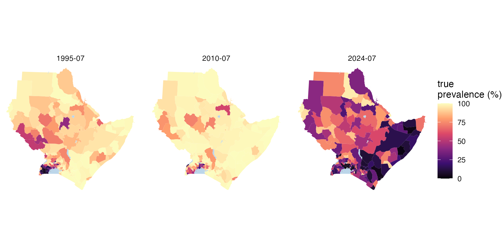
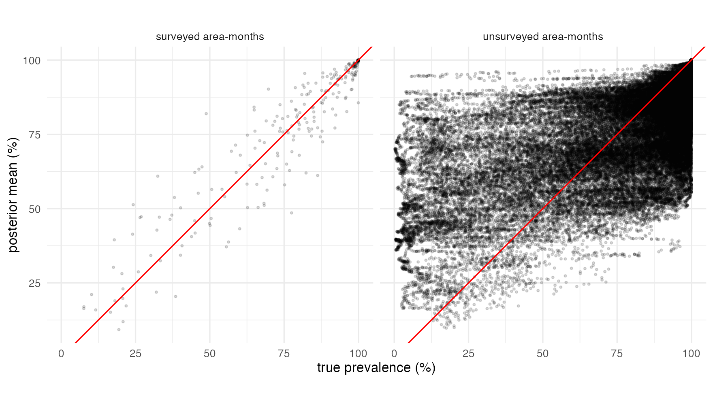
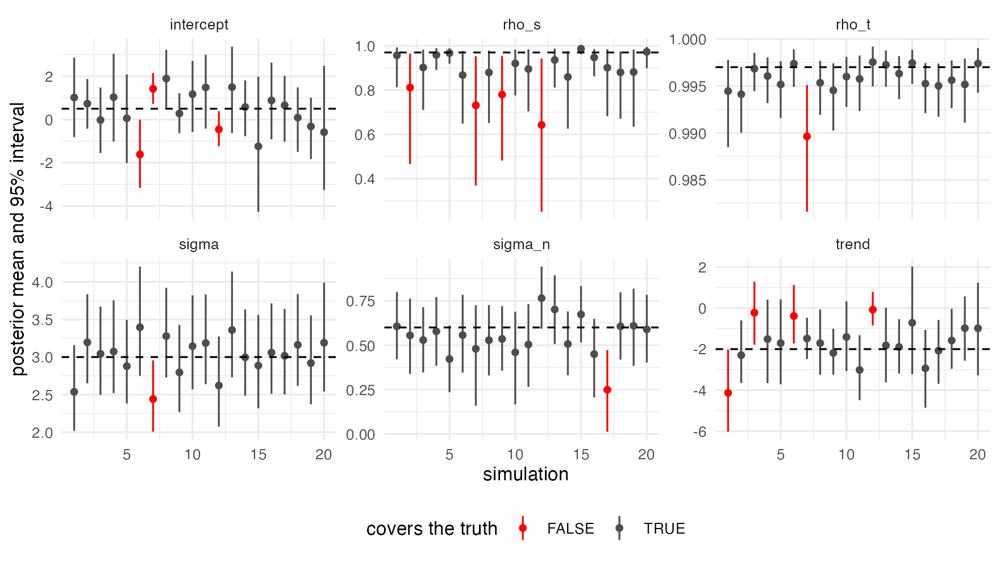

# 5. Simulate, fit, check

With real data, the truth is unknown, and a model can only be judged by
how well it predicts ([tutorial
4](https://mrc-ide.github.io/stareal/articles/crossval.md)). With
simulated data, the truth is known, so the fit can be checked against it
directly. This is worth doing for your own design before trusting a map.
Can these surveys, in these places and months, identify the parameters?
How wide should the intervals be where there are no data?

This tutorial simulates data at the survey design of [tutorial
1](https://mrc-ide.github.io/stareal/articles/crt76t.md): the same
area-months, with the same numbers tested. It fits the model, and
compares the result with the truth, first for one simulation and then
over twenty.

``` r
library(stareal)
```

## 1. Simulating at a real design

[`simulate_areal()`](https://mrc-ide.github.io/stareal/reference/simulate_areal.md)
draws one surface from the model and then binomial surveys. Given
`cells`, it surveys those area-time cells with their numbers tested. The
`$cells` of real data qualifies, so a simulation can copy a real design:

``` r
iso3 <- c("DJI", "ERI", "ETH", "KEN", "SOM", "SSD", "SDN", "UGA")
adm1 <- sf::st_as_sf(geodata::gadm(iso3, level = 1, path = tempdir(), version = "4.1", resolution = 2))
lakes <- rnaturalearth::ne_download(scale = 10, type = "lakes", category = "physical",
                                    returnclass = "sf", destdir = tempdir())
crs <- "+proj=laea +lat_0=8 +lon_0=37 +units=m"
adm1 <- sf::st_make_valid(sf::st_transform(adm1, crs))
lakes <- sf::st_make_valid(sf::st_transform(lakes, crs))
lakes <- lakes[as.numeric(sf::st_area(lakes)) > 1e9, ]
water <- sf::st_intersection(sf::st_union(lakes), sf::st_union(adm1))
adm1 <- sf::st_difference(adm1, water)
adm1 <- adm1[adm1$ENGTYPE_1 != "Water body", ]           # what is left of Uganda's lake units
fr <- areal_frame(adm1, id = "GID_1", groups = c(country = "COUNTRY"), link_within = "country",
                  verbose = FALSE)
tf <- time_frame(1989, 2024, "month")
d <- areal_data(igad_crt76t, fr, tf, y = "positive", k = "tested",
                coords = c("longitude", "latitude"), date = "collection_day", verbose = FALSE)
```

The parameters are of the same order as tutorial 1’s posterior: a strong
field, smooth in space and time, and a declining trend.

``` r
sim <- simulate_areal(fr, tf, cells = d$cells, sigma = 3, rho_s = 0.97, rho_t = 0.997,
                      sigma_n = 0.6, beta = c(intercept = 0.5, trend = -2), seed = 101)
sim
#> <stareal_data> 264 of 264 surveys used, pooled into 264 cells (simulated)
#>   59 of 172 units and 74 of 432 time steps have data (0.36% of the 74,304 area-time cells)
#>   tested per cell: median 54, range 1-1,310; total 23,844 tested, 18,443 positive
#>   truth: sigma 3, rho_s 0.97, rho_t 0.997, sigma_n 0.6; intercept 0.5, trend -2
```

The simulation is an ordinary data object, with the truth attached:
`sim$truth$prevalence` is the prevalence of every area in every month.

``` r
truth_map <- function(month) {
  m <- sf::st_sf(id = adm1$GID_1, geometry = sf::st_geometry(adm1))
  m$prevalence <- sim$truth$prevalence[m$id, month]
  m$time <- month
  m
}
tm <- do.call(rbind, lapply(c("1995-07", "2010-07", "2024-07"), truth_map))
ggplot(tm) +
  geom_sf(aes(fill = prevalence), colour = NA) +
  geom_sf(data = sf::st_sf(water), fill = "#bcd6ea", colour = NA) +
  facet_wrap(~time) +
  scale_fill_viridis_c("true\nprevalence (%)", limits = c(0, 100), option = "magma") +
  theme_void()
```



## 2. Fitting

The same call as for real data:

``` r
fit <- fit_areal(sim)
diagnose(fit)$checks
#>                      check      value threshold direction pass
#> 1        theta R-hat (max)   1.009348      1.05        <= TRUE
#> 2         beta R-hat (max)   1.004808      1.05        <= TRUE
#> 3       latent R-hat (max)   1.009497      1.05        <= TRUE
#> 4     theta bulk ESS (min) 464.525262    400.00        >= TRUE
#> 5      beta bulk ESS (min) 987.478915    400.00        >= TRUE
#> 6 latent bulk ESS (median) 961.730566    100.00        >= TRUE
```

## 3. The parameters against the truth

``` r
tab <- summary(fit)$table[, c("variable", "mean", "q2.5", "q97.5")]
tab$truth <- c(sim$truth$theta, sim$truth$beta)[tab$variable]
tab$covered <- tab$q2.5 <= tab$truth & tab$truth <= tab$q97.5
tab
#>    variable       mean        q2.5      q97.5  truth covered
#> 1     sigma  3.3394988  2.78231628  4.0273402  3.000    TRUE
#> 2     rho_s  0.8310090  0.58645818  0.9601813  0.970   FALSE
#> 3     rho_t  0.9934100  0.98897372  0.9966330  0.997   FALSE
#> 4   sigma_n  0.3612094  0.04172819  0.6559755  0.600    TRUE
#> 5 intercept  2.1937699  0.97223072  3.3500857  0.500   FALSE
#> 6     trend -1.8379738 -3.29124629 -0.2948046 -2.000    TRUE
```

3 of the 6 intervals cover their true values; the misses are rho_s,
rho_t, intercept. One simulation is one draw, though. Whether misses
like these are bad luck or a pattern is the job of the repeated study in
section 5.

## 4. The surface against the truth

The parameters are a means to an end; the map is what gets used.
[`predict()`](https://rdrr.io/r/stats/predict.html) gives every
area-month, and each can be checked against the true prevalence:

``` r
pr <- predict(fit)
pr$area$truth <- sim$truth$prevalence[cbind(pr$area$id, pr$area$time)]
pr$area$covered <- pr$area$q2.5 <= pr$area$truth & pr$area$truth <= pr$area$q97.5
pr$area$surveyed <- ifelse(pr$area$k > 0, "surveyed area-months", "unsurveyed area-months")
aggregate(cbind(covered, width = q97.5 - q2.5) ~ surveyed, pr$area, mean)
#>                 surveyed   covered    width
#> 1   surveyed area-months 0.9318182 22.81711
#> 2 unsurveyed area-months 0.9719881 73.58791
```

``` r
ggplot(pr$area, aes(truth, mean)) +
  geom_point(alpha = 0.15, size = 0.6) +
  geom_abline(colour = "red") +
  facet_wrap(~surveyed) +
  coord_equal() +
  labs(x = "true prevalence (%)", y = "posterior mean (%)") +
  theme_minimal()
```



Where there are surveys, the posterior mean follows the truth closely
and the intervals are narrow. Where there are none, which is most
area-months (only 59 of the 172 units have any data), the estimates
shrink toward the regional mean. Many unsurveyed units are far from it,
so the means scatter widely. But their intervals are about 3 times as
wide, and still cover the truth about as often as they should.

The coverage of one simulation moves with its estimated parameters,
which all its cells share. Section 5 averages over twenty simulations.

## 5. Over twenty simulations

One simulation is one draw: a parameter outside its interval might be
bad luck. The way to know is to repeat the exercise many times, with new
surfaces and surveys at the same design. That is twenty fits and twenty
predictions, too long for a tutorial, so it was run once with the code
above in a loop (`data-raw/simulation_crt76t.R` in the source
repository), keeping each parameter’s interval and the surface’s
coverage. The results ship with *stareal*:

``` r
study <- readRDS(system.file("extdata", "simulation_crt76t.rds", package = "stareal"))
params <- study$params
params$covered <- params$q2.5 <= params$truth & params$truth <= params$q97.5
aggregate(covered ~ variable, params, mean)
#>    variable covered
#> 1 intercept    0.85
#> 2     rho_s    0.80
#> 3     rho_t    0.95
#> 4     sigma    0.95
#> 5   sigma_n    0.95
#> 6     trend    0.80
```

``` r
ggplot(params, aes(rep, mean, ymin = q2.5, ymax = q97.5, colour = covered)) +
  geom_pointrange(size = 0.2) +
  geom_hline(aes(yintercept = truth), linetype = 2) +
  facet_wrap(~variable, scales = "free_y") +
  scale_colour_manual(values = c(`TRUE` = "grey30", `FALSE` = "red")) +
  labs(x = "simulation", y = "posterior mean and 95% interval", colour = "covers the truth") +
  theme_minimal() + theme(legend.position = "bottom")
```



``` r
aggregate(cbind(covered, width) ~ observed, study$surface, mean)
#>   observed   covered    width
#> 1    FALSE 0.9433428 75.98931
#> 2     TRUE 0.9380682 28.03930
```

With twenty simulations, an honest 95% interval misses the truth about
once, and two or three misses are not unusual. Over the twenty:

- `sigma` and `sigma_n` cover the truth 19 and 19 times.
- `rho_s` covers it 16 times and `rho_t` 19 times. Their misses all fall
  on the same side: the truth is just above the interval (4 of 4 for
  `rho_s`, 1 of 1 for `rho_t`). Both truths are close to 1. How close a
  correlation is to 1 is decided by a few broad patterns, which these
  data see only dimly, so the posterior leans toward the prior’s mass
  further from 1.
- The `intercept` and the `trend` cover the truth 17 and 16 times, with
  misses on both sides. The regional level and slope trade off against
  the field’s own region-wide component, whose variance is proportional
  to `sigma^2 / (1 - rho_s)`. When `rho_s` is estimated too low, that
  variance is understated, and the fit is too sure of the regional level
  and slope.
- The surface, which is what the maps are made of, covers the truth in
  about 94% of area-months, surveyed or not (the table above).
- [`diagnose()`](https://mrc-ide.github.io/stareal/reference/diagnose.md)
  passed 19 of the 20 fits at the default length. Check every fit: a fit
  that fails needs a longer run.

Is something wrong? Not with the software. A Bayesian 95% interval is
calibrated on average over the prior, not at every fixed truth, and a
truth near the edge of what the data can resolve is where it can
under-cover. Simulation-based calibration ([Talts et
al. 2018](https://arxiv.org/abs/1804.06788)) checks the software itself.
It draws the parameters from the prior, simulates, fits, and checks that
the truth’s rank among the posterior draws is uniform. For *stareal*,
200 such simulations on a small lattice gave uniform ranks for every
parameter (`data-raw/check_sbc.R` in the source repository).

The lesson for this design: the surface’s intervals can be taken at face
value. The correlations, and the regional intercept read as a result in
its own right, are less certain than their intervals say when the
correlations are close to 1. A simulation at your own design, like this
one, shows whether that applies to you.

## 6. What this does and does not show

A simulation from the model itself checks the software and the design:
that the sampler finds the posterior, and that these surveys can
identify the parameters. It cannot show that the model suits real data.
The simulated field is exactly the model’s field, with the same
smoothness everywhere, no outliers and no study effects.

Two extensions make the check harder and more useful:

- **Simulate from something else** and fit the model to it: a localised
  emergence like that of [tutorial
  2](https://mrc-ide.github.io/stareal/articles/k13-561h.md), a
  covariate the fit leaves out, or overdispersed surveys. The question
  then is whether the intervals stay honest when the model is wrong.
- **Simulate a design you are planning**: add the surveys you might
  collect to `cells`, and see how much the intervals in the unsurveyed
  areas shrink.

## What next

- [Method](https://mrc-ide.github.io/stareal/articles/method.md): what
  the model is and how it is fitted.
- [Reference](https://mrc-ide.github.io/stareal/reference/simulate_areal.md):
  the options of
  [`simulate_areal()`](https://mrc-ide.github.io/stareal/reference/simulate_areal.md),
  including covariates.
