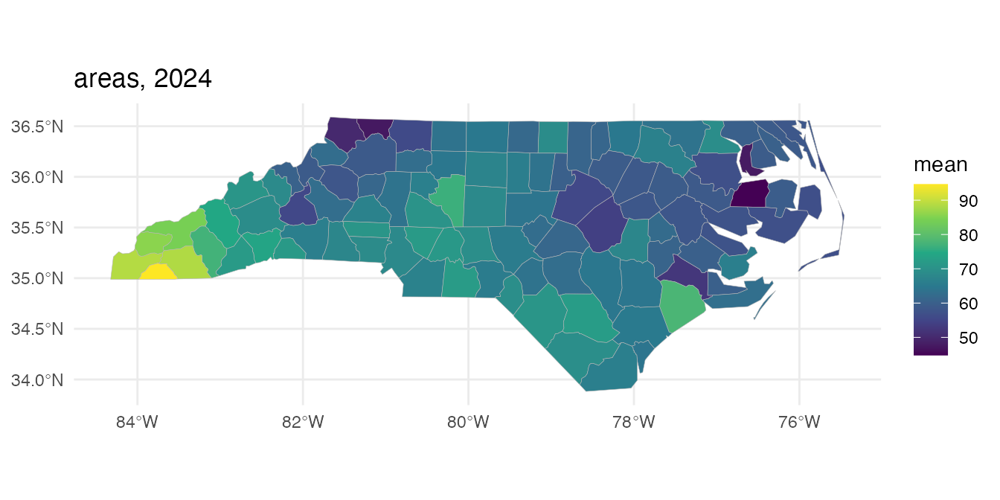
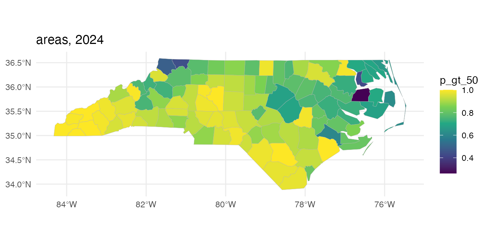
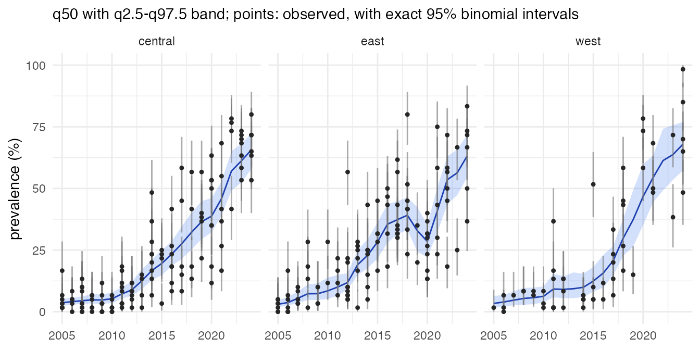
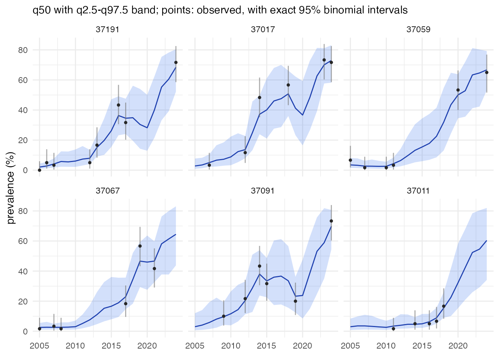

# Getting started with \*stareal\*

*stareal* maps prevalence from survey data, for example the share of
infections carrying a drug-resistance marker, on a set of areal units
(districts, counties, grid cells) and a regular time grid (months,
quarters, years). It estimates every area in every time step, with
uncertainty, including those that were never surveyed, and aggregates
the estimates to coarser groupings such as regions or countries.

This vignette runs through a complete analysis on simulated data, where
the truth is known. The [tutorials](https://mrc-ide.github.io/stareal/)
on the package website work through real analyses: the
chloroquine-resistance marker crt K76T across the Greater Horn of
Africa, an emerging artemisinin partial-resistance marker, covariates,
cross-validation and simulation studies. The data are the 100 counties
of North Carolina, which ship with the `sf` package, over 20 years.

## The model

Surveys report y positives out of k tested. Surveys in the same area and
time step are pooled into one *cell*. The number positive in cell (area
a, time t) is binomial, with logit prevalence

x\_{at} = z\_{at}^\top \beta + f\_{at} + \epsilon\_{at}.

- z\_{at}^\top \beta are fixed effects: an intercept, by default a
  linear trend, and any covariates.
- f is a Gaussian field with separable covariance.
  - In space it is a Leroux conditional autoregressive model on the
    adjacency graph of the areas, with scale \sigma and spatial
    dependence \rho_s.
  - In time it is a first-order autoregression with correlation \rho_t.
- \epsilon is a cell-level nugget with standard deviation \sigma_n, for
  variation between surveys that the smooth field does not explain.

Most area-time cells have no data. Because the prior is Gaussian, those
cells can be integrated out exactly, and so can \beta, so the sampler
works on the observed cells only. A fit to a few thousand observed cells
is then feasible, even when the full table has millions of cells. The
full surface is reconstructed afterwards, once per posterior draw.

## 1. The spatial frame

A frame holds the areas, their adjacency graph and any groupings to
aggregate to. It is built from polygons (or from an adjacency matrix, or
as a regular lattice with
[`areal_lattice()`](https://mrc-ide.github.io/stareal/reference/areal_lattice.md)).
Here the counties are grouped into three regions by longitude.

``` r
library(stareal)
nc <- sf::st_read(system.file("shape/nc.shp", package = "sf"), quiet = TRUE)
lon <- sf::st_coordinates(suppressWarnings(sf::st_centroid(sf::st_geometry(nc))))[, 1]
nc$region <- cut(lon, 3, labels = c("west", "central", "east"))
fr <- areal_frame(nc, id = "FIPS", groups = c(county = "NAME", region = "region"))
#> adjacency (queen) of 100 units
#> 100 units, 245 edges, mean 4.9 neighbours, 1 component
#> eigendecomposition of the graph Laplacian (m = 100)
fr
#> <stareal_frame> 100 units, 245 edges (mean 4.9 neighbours), 1 connected component
#>   built from: polygons
#>   groupings: county (100), region (3)
```

Areas sharing a border or a corner are neighbours. Islands, and any
other pieces of the graph cut off from the rest, are joined to the
nearest mainland area, so every area borrows strength from its
neighbours.

## 2. The time frame

``` r
tf <- time_frame(2005, 2024, "year")
tf
#> <stareal_time> yearly steps, 2005 to 2024 (20 steps)
```

## 3. Data

Real data are a table of surveys, each with a location (an area id, or
coordinates) and a date.
[`areal_data()`](https://mrc-ide.github.io/stareal/reference/areal_data.md)
assigns each survey to an area (by id, or by point in polygon, with
points just outside every polygon snapped to the nearest one) and to a
time step, then pools the surveys into cells. Every survey it cannot use
is kept, with the reason:

``` r
d <- areal_data(surveys, fr, tf, y = "positive", k = "tested",
                coords = c("lon", "lat"), date = "date")
d          # surveys used, cells, and every exclusion with its reason
```

Here the surveys are simulated from the model with known parameters: 300
county-years surveyed, 60 people tested in each.
[`simulate_areal()`](https://mrc-ide.github.io/stareal/reference/simulate_areal.md)
returns the same kind of object, with the truth attached.

``` r
sim <- simulate_areal(fr, tf, sigma = 1, rho_s = 0.9, rho_t = 0.8, sigma_n = 0.3,
                      beta = c(-1, 1.5), n_cells = 300, k = 60, seed = 42)
sim
#> <stareal_data> 300 of 300 surveys used, pooled into 300 cells (simulated)
#>   94 of 100 units and 20 of 20 time steps have data (15.00% of the 2,000 area-time cells)
#>   tested per cell: median 60, range 60-60; total 18,000 tested, 4,452 positive
#>   truth: sigma 1, rho_s 0.9, rho_t 0.8, sigma_n 0.3; intercept -1, trend 1.5
head(sim$cells)
#>    cell_id area    id  t time  y  k n_surveys
#> 3        3    1 37009  3 2007  4 60         1
#> 7        7    1 37009  7 2011  1 60         1
#> 19      19    1 37009 19 2023 23 60         1
#> 21      21    2 37005  1 2005  2 60         1
#> 25      25    2 37005  5 2009  2 60         1
#> 31      31    2 37005 11 2015  2 60         1
```

## 4. Fitting

The defaults of
[`mcmc_control()`](https://mrc-ide.github.io/stareal/reference/mcmc_control.md)
are a pilot run. Here a short run keeps the vignette quick; settings can
be given as a plain list, and anything left out takes its default.
Chains run in parallel, one per worker process.

``` r
fit <- fit_areal(sim, control = list(n_iter = 1500, n_burn = 500, n_store = 200, n_chains = 2,
                                     ess_sweeps = 5, n_cores = 2, verbose = FALSE))
summary(fit)
#> <stareal_fit summary> 300 observed cells; 2 chains, 1000 iterations after burn-in
#>   hyperparameters from the trace (2000 draws), fixed effects from the 400 stored draws
#> 
#>   variable   mean     sd    q2.5    q50  q97.5  rhat ess_bulk ess_tail
#>      sigma  1.020 0.0955  0.8400  1.020  1.200 1.015      176      326
#>      rho_s  0.860 0.0623  0.7150  0.867  0.956 1.015      180      346
#>      rho_t  0.759 0.0676  0.6100  0.767  0.878 1.009      274      347
#>    sigma_n  0.236 0.1110  0.0244  0.238  0.433 1.020      135       73
#>  intercept -1.510 0.1740 -1.8500 -1.520 -1.180 0.999      485      454
#>      trend  2.100 0.2110  1.7100  2.110  2.520 1.001      411      393
#> 
#> acceptance after burn-in: centred 0.21, surrogate 0.20; 0.0103 s per iteration
#> for every observed cell and a verdict, use diagnose()
sim$truth$theta
#>   sigma   rho_s   rho_t sigma_n 
#>     1.0     0.9     0.8     0.3
```

`plot(fit)` shows the traces.
[`diagnose()`](https://mrc-ide.github.io/stareal/reference/diagnose.md)
checks convergence and mixing for *every* parameter, including each
observed cell’s latent value. Hyperparameters can look converged while
the cells mix poorly, so a run is only accepted when both are
acceptable.

``` r
dg <- diagnose(fit)
dg$checks
#>                      check      value threshold direction  pass
#> 1        theta R-hat (max)   1.019898      1.05        <=  TRUE
#> 2         beta R-hat (max)   1.000617      1.05        <=  TRUE
#> 3       latent R-hat (max)   1.015124      1.05        <=  TRUE
#> 4     theta bulk ESS (min) 135.333808    400.00        >= FALSE
#> 5      beta bulk ESS (min) 411.368014    400.00        >=  TRUE
#> 6 latent bulk ESS (median) 359.025697    100.00        >=  TRUE
```

This short run fails the default thresholds (which are set for
publication), so a real analysis would run longer chains. For long fits,
give
[`fit_areal()`](https://mrc-ide.github.io/stareal/reference/fit_areal.md)
a `checkpoint_dir`: an interrupted fit, run again, resumes where it
stopped.

## 5. Prediction

[`predict()`](https://rdrr.io/r/stats/predict.html) reconstructs the
prevalence of every county in every year, once per posterior draw. It
then summarises each county-year, and aggregates each draw to the
regions before summarising. Because the regional estimates come from
joint draws, their uncertainty accounts for the correlation between
counties. Weights set each county’s share of its region; here they are
births in 1974. Prevalence is in percent, as everywhere in *stareal*,
and `exceedance = 50` asks for the probability that it exceeds 50%.

``` r
pr <- predict(fit, groups = "region", weights = setNames(nc$BIR74, nc$FIPS), exceedance = 50)
head(pr$area[, c("id", "county", "time", "y", "k", "mean", "q2.5", "q97.5", "p_gt_50")])
#>      id county time y  k     mean      q2.5     q97.5 p_gt_50
#> 1 37009   Ashe 2005 0  0 4.009324 0.9813753 11.786597       0
#> 2 37009   Ashe 2006 0  0 4.787831 1.2263265 11.653071       0
#> 3 37009   Ashe 2007 4 60 4.893090 1.5676222 11.238023       0
#> 4 37009   Ashe 2008 0  0 4.667554 1.1577566 11.563474       0
#> 5 37009   Ashe 2009 0  0 3.940569 1.0625088 10.991180       0
#> 6 37009   Ashe 2010 0  0 3.445353 0.7618511  9.271388       0
```

With the truth known, the coverage of the 95% intervals can be checked:

``` r
truth <- sim$truth$prevalence[cbind(match(pr$area$id, fr$ids), pr$area$t)]
mean(pr$area$q2.5 <= truth & truth <= pr$area$q97.5)
#> [1] 0.9565
```

``` r
plot(pr, time = "2024")
```



``` r
plot(pr, time = "2024", stat = "p_gt_50")
```



``` r
plot(pr, group = "region")
```



``` r
head(pr$groups$region)
#>        id t time       date     mean        sd     q2.5      q50    q97.5
#> 1 central 1 2005 2005-01-01 3.726438 0.7365112 2.512646 3.674818 5.253116
#> 2 central 2 2006 2006-01-01 4.099950 0.7582199 2.727516 4.092740 5.708326
#> 3 central 3 2007 2007-01-01 4.556141 0.7492840 3.334590 4.474539 6.247259
#> 4 central 4 2008 2008-01-01 4.930224 0.9785004 3.314606 4.822929 7.059305
#> 5 central 5 2009 2009-01-01 4.877104 0.9960221 3.273407 4.770890 7.100922
#> 6 central 6 2010 2010-01-01 5.362003 1.1414227 3.446921 5.266297 7.722430
#>   p_gt_50
#> 1       0
#> 2       0
#> 3       0
#> 4       0
#> 5       0
#> 6       0
```

``` r
plot(pr)   # the best-surveyed counties, with their data
```



## 6. Covariates

Covariates are given as tables keyed by area (`id`), by time step (`t`
or `time`), or by both. They must cover every area and time step, since
predictions are made everywhere. Numeric covariates are standardised, so
their effects are per standard deviation. Priors on the fixed effects
can be named by design column,
e.g. `priors = list(beta_sd = c(programmeon = 1))`.

``` r
covs <- list(data.frame(id = nc$FIPS, log_births = log(nc$BIR74)),
             data.frame(time = tf$labels, programme = ifelse(2005:2024 >= 2015, "on", "off")))
f_cov <- ~ trend() + log_births + programme
sim2 <- simulate_areal(fr, tf, formula = f_cov, covariates = covs, sigma = 0.8, rho_s = 0.9,
                       rho_t = 0.8, sigma_n = 0.3,
                       beta = c(-1, 1, 0.5, -0.7), n_cells = 300, k = 60, seed = 7)
fit2 <- fit_areal(sim2, formula = f_cov, covariates = covs,
                  control = list(n_iter = 1500, n_burn = 500, n_store = 200, n_chains = 2,
                                 ess_sweeps = 5, n_cores = 2, verbose = FALSE))
s <- summary(fit2)$table
s[s$type == "beta", c("variable", "mean", "q2.5", "q97.5")]
#>      variable       mean       q2.5      q97.5
#> 5   intercept -1.1192736 -1.4553362 -0.7512327
#> 6       trend  0.9509545  0.5067350  1.4025330
#> 7  log_births  0.5521311  0.4617428  0.6517247
#> 8 programmeon -0.5991866 -1.0818842 -0.1528443
sim2$truth$beta
#>   intercept       trend  log_births programmeon 
#>        -1.0         1.0         0.5        -0.7
```

## 7. Cross-validation

[`crossval()`](https://mrc-ide.github.io/stareal/reference/crossval.md)
holds out each fold of cells in turn, refits, and scores the held-out
cells. Compare models fitted to the same cells by the mean log score
(higher is better). About 5% of observations should fall outside their
95% predictive interval. Each fold is a full refit:

``` r
cv <- crossval(fit, folds = 10)
cv$overall
```

## Scale

Two things set the cost:

- **The eigendecomposition of the graph.**
  [`areal_frame()`](https://mrc-ide.github.io/stareal/reference/areal_frame.md)
  does it once. It is a dense m \times m problem, costing O(m^3): quick
  for hundreds of areas, noticeably slower for thousands. Build the
  frame once and save it with
  [`saveRDS()`](https://rdrr.io/r/base/readRDS.html).
- **Each MCMC iteration.** It costs O(n^3) in the number of observed
  cells n, because of a dense Cholesky factorisation. It does not depend
  on the number of areas or time steps.

The sampler is almost entirely dense linear algebra, so an optimised
BLAS (Intel MKL, OpenBLAS or Apple Accelerate) makes a large difference
over R’s reference BLAS. The method was developed on about 1,300 and
1,800 observed cells. Prediction holds one block of areas at a time, so
memory stays bounded however many draws are used.
